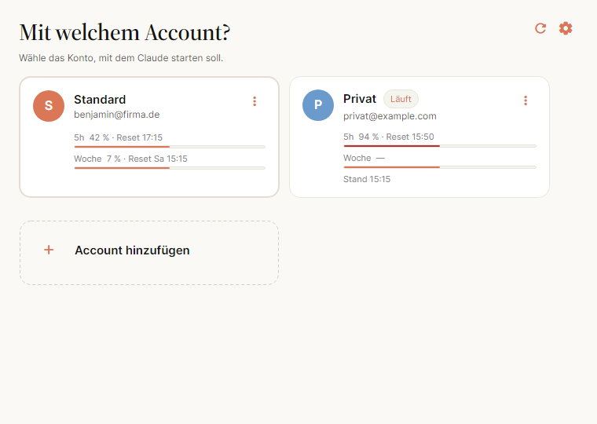
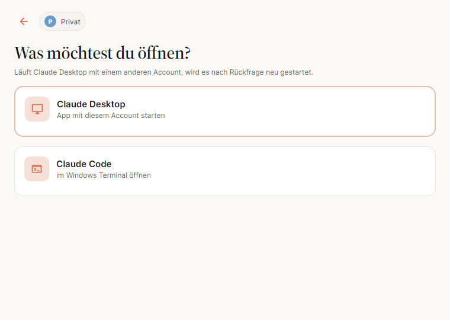

# MCACC — Claude Account Switcher

MCACC startet **Claude Desktop** und **Claude Code** mit dem Account, den du auswählst — ohne
dich jedes Mal ab- und wieder anzumelden.

Jeder Account bekommt ein eigenes Profil: Claude Desktop startet mit `--user-data-dir`, Claude
Code mit `CLAUDE_CONFIG_DIR`. Beides zeigt auf einen Ordner unter `~/.mcacc/`. Dein heutiges
Setup bleibt unangetastet und heißt in MCACC **„Standard“**.





## Voraussetzungen

- Windows 11 oder macOS 14 (Sonoma) und neuer
- Claude Desktop, falls du es starten willst
- Claude Code (`claude` im PATH), falls du es starten willst
- Zum Selberbauen: .NET SDK 10.0.301 oder neuer

## Installation

### Windows

1. `MCACC-<version>-win-x64.zip` entpacken.
2. `MCACC.exe` starten.

Beim ersten Start meldet sich **SmartScreen**, weil die Datei nicht signiert ist:
*Weitere Informationen* → *Trotzdem ausführen*.

Selber bauen:

```powershell
.\scripts\publish-windows.ps1 -Version 0.1.0
```

### macOS

Auf dem Mac bauen:

```bash
./scripts/build-macos.sh --arch arm64 --version 0.1.0
# oder: --arch universal   (arm64 + x64 in einem Bundle)
```

Das Ergebnis liegt in `artifacts/MCACC.app`. Es ist nur **ad-hoc signiert**, deshalb beim
ersten Start entweder Rechtsklick → *Öffnen*, oder einmalig:

```bash
xattr -dr com.apple.quarantine MCACC.app
```

## Bedienung

1. **Account wählen.** Jede Kachel zeigt Name, Login-E-Mail und die Nutzungslimits
   (5 Stunden und Woche). Läuft Claude Desktop gerade mit diesem Account, steht dort „Läuft“.
2. **Ziel wählen.**
   - **Claude Desktop** startet die App mit dem Profil des Accounts. Läuft sie schon mit einem
     anderen Account, fragt MCACC nach und startet sie neu.
   - **Claude Code** öffnet ein Terminal im Home-Ordner mit gesetztem `CLAUDE_CONFIG_DIR` und
     ruft `claude` auf. Nach `/exit` bleibt die Shell offen, die Variable bleibt gesetzt.

Nach einem erfolgreichen Start blendet sich MCACC aus (abschaltbar in den Einstellungen).

### Infobereich und Menüleiste

MCACC bleibt nach dem Start dauerhaft als Icon im Windows-Infobereich bzw. in der macOS-Menüleiste.
Das Fenster zu schließen blendet es nur aus. Beendet wird MCACC erst über **MCACC beenden** im
Menü des Icons oder mit Cmd+Q.

- **Windows:** Linksklick öffnet das Fenster, Rechtsklick das Menü.
- **macOS:** Ein Klick öffnet das Menü. Das Dock-Icon ist nur zu sehen, solange das Fenster offen
  ist; ein Klick darauf öffnet es wieder.

Das Menü enthält pro Account ein Untermenü mit den Limits (oder dem Hinweis, warum keine da sind)
und den Punkten **Claude Desktop starten** und **Claude Code starten**; „läuft“ steht dabei, wenn
Claude Desktop mit dem Account läuft. Ein Start von dort bleibt unsichtbar, solange keine Rückfrage
nötig ist; bei einem Konflikt oder Fehler öffnet sich das Fenster. Dazu kommen **Limits
aktualisieren** und **Einstellungen …**. Der Tooltip zeigt die Limits des zuletzt genutzten Accounts.

Ein zweiter Start von MCACC öffnet nur das Fenster der laufenden Instanz. Nach dem Ausblenden
beginnt das Fenster wieder bei der Account-Auswahl.

### Anmelden

Claude Desktop reicht die Anmeldung an den Standardbrowser weiter. Der kommt mit einer
`claude://`-Adresse zurück, und die öffnet Windows bzw. macOS mit dem registrierten Handler —
also ohne `--user-data-dir` und damit im Standardprofil. Ohne Gegenmaßnahme landet die
Anmeldung deshalb im falschen Account.

Darum bleibt MCACC nach dem Start eines Profil-Accounts bis zu drei Minuten offen und sagt das
auch. Taucht in dieser Zeit so ein Start auf, beendet MCACC ihn, bevor er den einmaligen Code
einlösen kann, und übergibt die Adresse an das Profil des gewählten Accounts. Danach schließt
sich MCACC aus. Wer nicht warten will, schließt das Fenster einfach selbst.

### Tastatur

| Taste | Wirkung |
| --- | --- |
| Pfeiltasten | Kachel wechseln |
| Enter | Auswählen |
| 1 – 9 | Den n-ten Account direkt wählen |
| D / C | Auf der Zielseite: Desktop bzw. Code |
| Esc / Backspace | Zurück, auf der ersten Seite: ausblenden |
| F2 | Den fokussierten Account umbenennen |
| Entf | Den fokussierten Account entfernen |
| Strg/Cmd + N | Neuen Account anlegen |
| Strg/Cmd + , | Einstellungen |

Der zuletzt genutzte Account und das zuletzt genutzte Ziel sind vorab fokussiert — zweimal
Enter genügt.

### Accounts anlegen

Beim Anlegen kannst du Einstellungen aus einem vorhandenen Account übernehmen: `CLAUDE.md`,
`settings.json`, Agents, Skills, Commands, Scripts und die MCP-Server von Claude Desktop.
**Niemals kopiert** werden `.credentials.json`, `.claude.json`, History, Projekte, Sessions und
Plugins — der neue Account meldet sich also selbst an.

Die Unteroption *Pfade anpassen* schreibt Verweise in der kopierten `settings.json` vom
Quellordner auf den neuen Ordner um.

### Accounts entfernen

Standardmäßig verschwindet der Account nur aus der Liste, die Daten bleiben liegen. Mit
*Daten auch löschen* werden die beiden Profilordner endgültig gelöscht; der Dialog zeigt sie
vorher an. Läuft Claude Desktop noch mit diesem Account, wird das Löschen abgelehnt. Der
Account „Standard“ lässt sich nicht entfernen, und seine Daten werden nie gelöscht.

### Info & Statistik

Im ⋮-Menü einer Kachel öffnet **Info & Statistik** eine Seite mit allem, was sich über den Account auslesen lässt:

- **Konto:** E-Mail, Name, Plan, Organisation, Abrechnung, Rate-Limit-Stufe, Ablauf des Tokens, Claude-Code-Starts und seit wann Claude Desktop läuft.
- **Limits:** 5h, Woche und weitere Fenster als Ringe, dazu der Verlauf der letzten 24 Stunden oder 7 Tage. MCACC fragt die Limits alle 5 Minuten ab, solange es läuft; der Verlauf wächst nur in dieser Zeit.
- **Claude Code Nutzung:** Tokens, Sessions, Nachrichten und aktive Tage aus den lokalen Session-Logs (`<claude-dir>/projects/**/*.jsonl`), als Tagesbalken nach Modell, nach Token-Art, nach Projekt und als Modelltabelle, für 7, 30 oder 90 Tage.

Die Kosten sind eine **Schätzung** zu API-Listenpreisen („≈“). Mit einem Abo zahlst du sie nicht; sie zeigen nur, was dieselbe Nutzung über die API gekostet hätte. Der erste Aufruf liest alle Logs und kann bei großen Verzeichnissen einige Sekunden dauern; danach liest MCACC nur, was neu hinzugekommen ist.

### Einstellungen

- **Terminal für Claude Code** — nur tatsächlich installierte werden angeboten.
- **Shell im Windows Terminal** — PowerShell 7, Windows PowerShell oder Eingabeaufforderung.
- **Nach dem Start ausblenden** — MCACC bleibt im Infobereich bzw. in der Menüleiste.
- **Datenordner** mit Knopf zum Öffnen im Explorer bzw. Finder.

## Datenablage

```
~/.mcacc/                        (Windows: %USERPROFILE%\.mcacc)
  config.json                    Accounts und Einstellungen (+ .bak)
  usage-cache.json               zuletzt bekannte Limits, ohne Tokens
  profile-cache.json             Profil je Account (E-Mail, Plan, Organisation), ohne Tokens
  usage-history/<id>.jsonl       Verlauf der Limits, 90 Tage
  stats/<id>.json                Index der gelesenen Claude-Code-Logs
  profiles/<id>/desktop/         --user-data-dir von Claude Desktop
  profiles/<id>/claude/          CLAUDE_CONFIG_DIR von Claude Code
  launch/<id>.cmd | .command     bei jedem Start neu erzeugt
  logs/mcacc-YYYYMMDD.log        7 Tage; Kommandos und Variablennamen, nie Tokens
```

Mit der Umgebungsvariablen `MCACC_HOME` lässt sich der Ordner umbiegen — praktisch zum
Ausprobieren, ohne das echte Setup anzufassen.

## Bekannte Einschränkungen

- **Login über Browser-SSO landet unter Windows möglicherweise im Standardprofil.** Der
  `claude://`-Deeplink ist systemweit auf Claude Desktop *ohne* Profil-Flag registriert. Wenn
  der Login im falschen Profil landet: in der App per E-Mail anmelden, oder anmelden, solange
  keine andere Instanz läuft.
- **Die Nutzungslimits kommen von einem inoffiziellen Endpunkt** (`/api/oauth/usage`), den auch
  Claude Code benutzt. Er ist ratenbegrenzt und kann sich jederzeit ändern. MCACC liest das
  Token nur, erneuert es nie und zeigt bei einem Fehler den letzten bekannten Wert mit
  Zeitstempel. Ist das Token abgelaufen, hilft ein Start von Claude Code.
- **MCACC prüft, wem das Token gehört.** Einmal pro Token fragt es `/api/oauth/profile`. Gehört
  das Token zu einem anderen Account als dem, den `.claude.json` nennt, zeigt die Kachel keine
  Limits, sondern „Claude Code ist hier mit … angemeldet – im Profil neu anmelden“. Dann läuft
  auch `claude` in diesem Profil mit dem fremden Account. Abhilfe: im Profil `claude` starten
  und mit `/login` den richtigen Account wählen.
- **Platzbedarf:** Jedes Desktop-Profil lädt eigene claude-code-Binaries und VM-Bundles, also
  mehrere hundert MB pro Account.
- **macOS fragt beim ersten Lesen der Limits nach Zugriff auf den Schlüsselbund.** Das ist der
  normale Weg, an das Token von Claude Code zu kommen; ohne Zustimmung bleiben die Limits leer.
- **Signatur:** Windows zeigt SmartScreen, macOS Gatekeeper — die Binaries sind nicht signiert
  bzw. nur ad-hoc signiert.
- Linux wird nicht unterstützt.

## Entwicklung

```bash
dotnet build MCACC.slnx
dotnet test MCACC.slnx
```

- **Nicht aus dem Code-Tab von Claude Desktop heraus testen.** Dort ist das Dateisystem
  virtualisiert, und das Beenden von Claude Desktop beendet die Session. Eine eigenständige
  `claude`-Session im Terminal oder der Start aus Rider bzw. dem Explorer ist der richtige Weg.
- `MCACC.exe --diagnose` schreibt einen Bericht nach `~/.mcacc/logs/diagnose.txt`: gefundene
  Installation, Terminals, laufende Instanzen mit PIDs und Profilordner, Pfade je Account. Er
  enthält keine Tokens und von E-Mail-Adressen nur die Domain.
- `MCACC_SHOTS=<ordner> dotnet test tests/Mcacc.App.Tests` rendert alle Seiten als PNG.
- Projektaufbau: `Mcacc.Core` (reine Logik, startet nie Prozesse) · `Mcacc.Platform` (die
  einzige Stelle mit Process, WMI, libc, Keychain und HTTP) · `Mcacc.App` (Avalonia, MVVM).
- Spezifikation und Plan liegen unter `docs/superpowers/`, die Spike-Fragen in
  `docs/spike-checklist.md` und deren Ergebnisse in `docs/spike-results.md`.

## Lizenzen der mitgelieferten Schriften

- **Source Serif 4** (Adobe) — SIL Open Font License 1.1, siehe
  `src/Mcacc.App/Assets/Fonts/OFL.txt`
- **Material Icons Round** (Google) — Apache License 2.0, siehe
  `src/Mcacc.App/Assets/Fonts/LICENSE-material-icons.txt`
- **Inter** — über das Paket `Avalonia.Fonts.Inter`, SIL Open Font License 1.1
