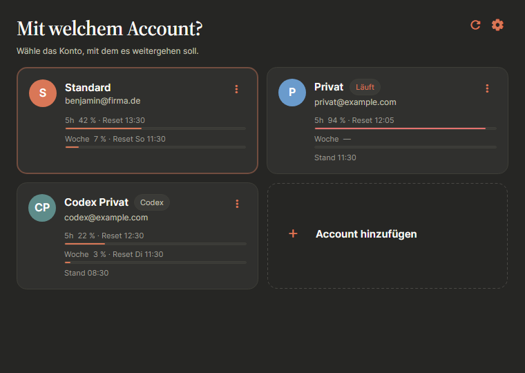
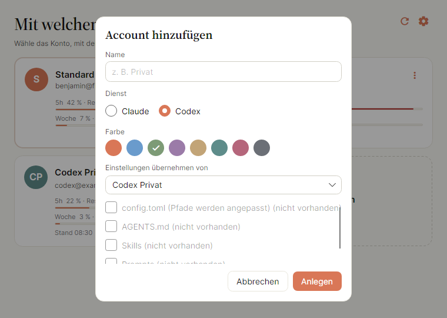
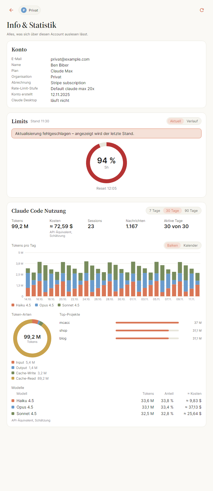

<div align="center">


# MCACC

**Mehrere Claude- und Codex-Accounts auf einem Rechner – ein Klick statt ab- und wieder anmelden.**

[](https://github.com/BenjaminBiber/MCACC/releases/latest)
[](LICENSE)


[Download](https://github.com/BenjaminBiber/MCACC/releases/latest) ·
[Schnellstart](#schnellstart) ·
[Bedienung](#bedienung) ·
[Entwicklung](#entwicklung)


</div>

MCACC startet **Claude Desktop** und **Claude Code** – und ebenso die **ChatGPT-/Codex-App** und die
**Codex-CLI** – mit dem Account, den du auswählst. Jeder Account bekommt ein eigenes, sauber getrenntes
Profil; Abmelden, Anmelden und Konfigurationen hin- und herkopieren entfallen.

Technisch startet MCACC Claude Desktop mit `--user-data-dir` und Claude Code mit `CLAUDE_CONFIG_DIR`
(bei Codex: `CODEX_HOME`). Alles zeigt auf einen Ordner unter `~/.mcacc/`. Dein heutiges Setup bleibt
unangetastet und heißt in MCACC **„Standard“**.

## Inhalt

- [Funktionen](#funktionen)
- [Screenshots](#screenshots)
- [Voraussetzungen](#voraussetzungen)
- [Installation](#installation)
- [Schnellstart](#schnellstart)
- [Bedienung](#bedienung)
  - [Infobereich und Menüleiste](#infobereich-und-menüleiste)
  - [Anmelden](#anmelden)
  - [Mehrere Accounts gleichzeitig](#mehrere-accounts-gleichzeitig)
  - [Tastatur](#tastatur)
  - [Accounts anlegen](#accounts-anlegen)
  - [Accounts entfernen](#accounts-entfernen)
  - [Info & Statistik](#info--statistik)
  - [Einstellungen](#einstellungen)
- [Codex-Accounts](#codex-accounts)
- [Datenablage](#datenablage)
- [Bekannte Einschränkungen](#bekannte-einschränkungen)
- [Entwicklung](#entwicklung)
- [Release erstellen](#release-erstellen)
- [Lizenz](#lizenz)

## Funktionen

- **Ein Profil pro Account** für Claude Desktop, Claude Code, die ChatGPT-/Codex-App und die Codex-CLI.
- **Nutzungslimits auf einen Blick:** 5-Stunden- und Wochenfenster je Account, mit Verlauf über 24 Stunden
  oder 7 Tage.
- **Info & Statistik:** Tokens, Sessions, Modelle, Projekte und geschätzte API-Kosten aus den lokalen
  Claude-Code-Logs.
- **Anmeldung landet im richtigen Profil:** MCACC fängt den `claude://`-Rücksprung aus dem Browser ab und
  reicht ihn an den gewählten Account weiter.
- **Mehrere Accounts gleichzeitig** (optional): jede Desktop-Instanz in einem eigenen Fenster.
- **Infobereich bzw. Menüleiste:** Accounts und Limits direkt aus dem Tray-Menü starten.
- **Einstellungen übernehmen:** `CLAUDE.md`, `settings.json`, Agents, Skills, Commands und MCP-Server aus
  einem vorhandenen Account kopieren – nie Zugangsdaten.
- **Tastaturbedienung:** zweimal Enter startet den zuletzt genutzten Account im zuletzt genutzten Ziel.
- Helles und dunkles Design, Windows 11 und macOS 14+.

## Screenshots

<table>
  <tr>
    <td width="50%"><br><sub><b>Ziel wählen</b> – Desktop-App oder Terminal mit Claude Code</sub></td>
    <td width="50%"><br><sub><b>Dunkles Design</b> – folgt der Systemeinstellung</sub></td>
  </tr>
  <tr>
    <td width="50%"><br><sub><b>Account anlegen</b> – Dienst, Farbe und übernommene Einstellungen</sub></td>
    <td width="50%"><br><sub><b>Info & Statistik</b> – Konto, Limits und Claude-Code-Nutzung</sub></td>
  </tr>
</table>

## Voraussetzungen

- Windows 11 oder macOS 14 (Sonoma) und neuer
- Claude Desktop bzw. die ChatGPT-/Codex-App, falls du sie starten willst
- Claude Code (`claude` im PATH) bzw. die Codex-CLI (`codex`), falls du sie starten willst
- Zum Selberbauen: .NET SDK 10.0.301 oder neuer

## Installation

Fertige Builds liegen unter [**Releases**](https://github.com/BenjaminBiber/MCACC/releases/latest).

| System | Datei | Hinweis |
| --- | --- | --- |
| Windows 11 | `MCACC-<version>-win-x64-setup.exe` | Empfohlen. Installiert ohne Adminrechte nach `%LOCALAPPDATA%\Programs\MCACC`. |
| Windows 11 | `MCACC-<version>-win-x64.zip` | Portabel: entpacken, `MCACC.exe` starten. |
| macOS 14+ | `MCACC-<version>-macos-universal.dmg` | Apple Silicon und Intel. `MCACC.app` nach *Programme* ziehen. |

### Windows

Installer ausführen oder das Zip entpacken und `MCACC.exe` starten. Beim ersten Start meldet sich
**SmartScreen**, weil die Datei nicht signiert ist: *Weitere Informationen* → *Trotzdem ausführen*.

Der Installer legt einen Startmenü-Eintrag an und entfernt beim Deinstallieren auch den Autostart-Eintrag.

### macOS

DMG öffnen und `MCACC.app` in den Ordner *Programme* ziehen. Die App ist nur **ad-hoc signiert**, deshalb
beim ersten Start entweder Rechtsklick → *Öffnen*, oder einmalig:

```bash
xattr -dr com.apple.quarantine /Applications/MCACC.app
```

### Selbst bauen

```powershell
# Windows: Zip, mit -Installer zusätzlich setup.exe (braucht Inno Setup 6)
.\scripts\publish-windows.ps1 -Version 0.1.0 -Installer
```

```bash
# macOS: MCACC.app, Zip und DMG unter artifacts/
./scripts/build-macos.sh --arch universal --version 0.1.0   # oder --arch arm64 / x64
```

## Schnellstart

1. MCACC starten. Dein bisheriges Setup erscheint als Account **„Standard“**.
2. **Account hinzufügen** → Namen vergeben, Dienst (Claude oder Codex) und Farbe wählen, optional
   Einstellungen aus „Standard“ übernehmen.
3. Den neuen Account wählen, dann **Claude Desktop** oder **Claude Code**.
4. Im neuen Profil einmal anmelden. Ab dann reicht ein Klick – oder zweimal Enter.

## Bedienung

1. **Account wählen.** Jede Kachel zeigt Name, Login-E-Mail und die Nutzungslimits
   (5 Stunden und Woche). Läuft Claude Desktop gerade mit diesem Account, steht dort „Läuft“.
2. **Ziel wählen.**
   - **Claude Desktop** startet die App mit dem Profil des Accounts. Läuft sie schon mit einem
     anderen Account, fragt MCACC nach und startet sie neu. Mit der Einstellung **Mehrere Accounts
     gleichzeitig öffnen** bleibt sie stattdessen offen, und der gewählte Account bekommt ein
     eigenes Fenster (siehe *Mehrere Accounts gleichzeitig*).
   - **Claude Code** öffnet ein Terminal im Home-Ordner mit gesetztem `CLAUDE_CONFIG_DIR` und
     ruft `claude` auf. Nach `/exit` bleibt die Shell offen, die Variable bleibt gesetzt.

Nach einem erfolgreichen Start blendet sich MCACC aus (abschaltbar in den Einstellungen).

### Infobereich und Menüleiste

MCACC bleibt nach dem Start dauerhaft als Icon im Windows-Infobereich bzw. in der macOS-Menüleiste.
Das Fenster zu schließen blendet es nur aus. Beendet wird MCACC erst über **MCACC beenden** im
Menü des Icons oder mit Cmd+Q.

- **Windows:** Linksklick öffnet das Fenster, Rechtsklick das Menü.
- **macOS:** Ein Klick öffnet das Menü. Das Dock-Icon ist nur zu sehen, solange das Fenster offen
  ist; ein Klick darauf öffnet es wieder.

Das Menü enthält pro Account ein Untermenü mit den Limits (oder dem Hinweis, warum keine da sind)
und den Punkten **Claude Desktop starten** und **Claude Code starten**; „läuft“ steht dabei, wenn
Claude Desktop mit dem Account läuft. Ein Start von dort bleibt unsichtbar, solange keine Rückfrage
nötig ist; bei einem Konflikt oder Fehler öffnet sich das Fenster. Dazu kommen **Limits
aktualisieren** und **Einstellungen …**. Der Tooltip zeigt die Limits des zuletzt genutzten Accounts.

Ein zweiter Start von MCACC öffnet nur das Fenster der laufenden Instanz. Nach dem Ausblenden
beginnt das Fenster wieder bei der Account-Auswahl.

**Bei der Anmeldung starten** (Einstellungen, standardmäßig an): MCACC startet versteckt im
Infobereich bzw. in der Menüleiste und zeichnet die Limits auf, auch wenn das Fenster nie geöffnet
wird. Unter Windows steht dafür der Wert `MCACC` unter
`HKCU\Software\Microsoft\Windows\CurrentVersion\Run`, unter macOS
`~/Library/LaunchAgents/de.benjaminbiber.mcacc.plist` (wirkt ab der nächsten Anmeldung). Ein Start
mit `--hidden` holt das Fenster einer laufenden Instanz nicht nach vorne. Debug-Builds und Läufe mit
`MCACC_HOME` legen keinen Eintrag an. macOS meldet den neuen Eintrag einmal als „Hintergrundobjekt
hinzugefügt“. Läuft MCACC aus einem Zip heraus oder unter macOS noch aus dem Download-Ordner (App
Translocation), legt es keinen Eintrag an. Vor dem Löschen von MCACC den Schalter ausschalten, sonst
bleibt der Eintrag stehen.

### Anmelden

Claude Desktop reicht die Anmeldung an den Standardbrowser weiter. Der kommt mit einer
`claude://`-Adresse zurück, und die öffnet Windows bzw. macOS mit dem registrierten Handler —
also ohne `--user-data-dir` und damit im Standardprofil. Ohne Gegenmaßnahme landet die
Anmeldung deshalb im falschen Account.

Darum bleibt MCACC nach dem Start eines Profil-Accounts bis zu drei Minuten offen und sagt das
auch. Taucht in dieser Zeit so ein Start auf, beendet MCACC ihn, bevor er den einmaligen Code
einlösen kann, und übergibt die Adresse an das Profil des gewählten Accounts. Danach schließt
sich MCACC aus. Wer nicht warten will, schließt das Fenster einfach selbst.
Startest du in dieser Zeit einen weiteren Account, gilt die Überwachung nur noch für ihn.

### Mehrere Accounts gleichzeitig

Standardmäßig läuft die Desktop-App mit einem Account zur Zeit. Mit **Mehrere Accounts gleichzeitig
öffnen** (Einstellungen, standardmäßig aus) beendet MCACC beim Start nichts mehr: Jeder Account
läuft als eigene Instanz in einem eigenen Fenster, und „Läuft“ steht dann bei mehreren Accounts.
Startest du einen Account, der schon läuft, kommt nur sein Fenster nach vorne. Der Schalter wirkt
ab dem nächsten Start; laufende Instanzen bleiben, wie sie sind.

Für die Anmeldung über den Browser gilt dabei eine Regel: **Die Anmeldung geht an den Account, der
zuletzt gestartet wurde.** Die zurückkommende `claude://`-Adresse nennt keinen Account, deshalb
überwacht MCACC je App immer nur den letzten Start. Also erst einen Account starten und anmelden,
dann den nächsten starten. Ein Start des Standard-Accounts beendet die Überwachung; eine Anmeldung
landet danach im Standardprofil.

### Tastatur

| Taste | Wirkung |
| --- | --- |
| Pfeiltasten | Kachel wechseln |
| Enter | Auswählen |
| 1 – 9 | Den n-ten Account direkt wählen |
| D / C | Auf der Zielseite: Desktop bzw. Code |
| Esc / Backspace | Zurück, auf der ersten Seite: ausblenden |
| F2 | Den fokussierten Account umbenennen |
| Entf | Den fokussierten Account entfernen |
| Strg/Cmd + N | Neuen Account anlegen |
| Strg/Cmd + , | Einstellungen |

Der zuletzt genutzte Account und das zuletzt genutzte Ziel sind vorab fokussiert — zweimal
Enter genügt.

### Accounts anlegen

Beim Anlegen kannst du Einstellungen aus einem vorhandenen Account übernehmen: `CLAUDE.md`,
`settings.json`, Agents, Skills, Commands, Scripts und die MCP-Server von Claude Desktop.
**Niemals kopiert** werden `.credentials.json`, `.claude.json`, History, Projekte, Sessions und
Plugins — der neue Account meldet sich also selbst an.

Die Unteroption *Pfade anpassen* schreibt Verweise in der kopierten `settings.json` vom
Quellordner auf den neuen Ordner um.

### Accounts entfernen

Standardmäßig verschwindet der Account nur aus der Liste, die Daten bleiben liegen. Mit
*Daten auch löschen* werden die beiden Profilordner endgültig gelöscht; der Dialog zeigt sie
vorher an. Läuft Claude Desktop noch mit diesem Account, wird das Löschen abgelehnt. Der
Account „Standard“ lässt sich nicht entfernen, und seine Daten werden nie gelöscht.

### Info & Statistik

Im ⋮-Menü einer Kachel öffnet **Info & Statistik** eine Seite mit allem, was sich über den Account auslesen lässt:

- **Konto:** E-Mail, Name, Plan, Organisation, Abrechnung, Rate-Limit-Stufe, Ablauf des Tokens, Claude-Code-Starts und seit wann Claude Desktop läuft.
- **Limits:** 5h, Woche und weitere Fenster als Ringe, dazu der Verlauf der letzten 24 Stunden oder 7 Tage. MCACC fragt die Limits alle 5 Minuten ab, solange es läuft, und nach einem Start von Claude Code nach 15 und 60 Sekunden noch einmal, weil Claude Code einen abgelaufenen Token erst beim Start erneuert; der Verlauf wächst nur in dieser Zeit. Lücken, in denen MCACC nicht lief, sind gestrichelt geschätzt („nicht gemessen“): Fällt ein Reset hinein, hält die Linie bis zum Reset, fällt auf 0 und steigt ab dem Beginn des nächsten Fensters zum nächsten Messpunkt.
- **Claude Code Nutzung:** Tokens, Sessions, Nachrichten und aktive Tage aus den lokalen Session-Logs (`<claude-dir>/projects/**/*.jsonl`), als Tagesbalken nach Modell, nach Token-Art, nach Projekt und als Modelltabelle, für 7, 30 oder 90 Tage.

Die Kosten sind eine **Schätzung** zu API-Listenpreisen („≈“). Mit einem Abo zahlst du sie nicht; sie zeigen nur, was dieselbe Nutzung über die API gekostet hätte. Der erste Aufruf liest alle Logs und kann bei großen Verzeichnissen einige Sekunden dauern; danach liest MCACC nur, was neu hinzugekommen ist.

### Einstellungen

- **Terminal für die Kommandozeile** — nur tatsächlich installierte werden angeboten.
- **Shell im Windows Terminal** — PowerShell 7, Windows PowerShell oder Eingabeaufforderung.
- **Nach dem Start ausblenden** — MCACC bleibt im Infobereich bzw. in der Menüleiste.
- **Bei der Anmeldung starten** — legt den Autostart-Eintrag an bzw. entfernt ihn (siehe
  *Infobereich und Menüleiste*).
- **Mehrere Accounts gleichzeitig öffnen** — die Desktop-App bleibt beim Start eines anderen
  Accounts offen, statt nach Rückfrage neu zu starten (siehe *Mehrere Accounts gleichzeitig*).
- **Claude-Limits über die Statusline mitschreiben** — MCACC trägt sich als Statusline in die
  `settings.json` der Claude-Accounts ein und merkt sich die Limits, die Claude Code nach jeder Antwort
  meldet. Kann MCACC die Limits nicht abrufen, zeigt die Kachel diesen Stand. Accounts mit eigener
  Statusline bleiben unangetastet.
- **Projekte in der Statistik** — alle Projekte aus den Claude-Code-Logs aller Accounts, nach
  Tokens sortiert. Ein Projekt ohne Häkchen zählt auf der Info-Seite nirgends mit: nicht in Tokens,
  Kosten, Sessions, Tagesbalken, Modellen, Top-Projekten und Kalender. Geschätzte Kalendertage
  werden anteilig gekürzt, weil Claudes Zusammenfassung keine Projekte kennt. Die Info-Seite nennt,
  wie viele Projekte des Accounts ausgeschlossen sind.
- **Datenordner** mit Knopf zum Öffnen im Explorer bzw. Finder.

## Codex-Accounts

Beim Anlegen lässt sich als Dienst **Codex** statt Claude wählen. Die Kachel trägt dann das Abzeichen
„Codex“, und die Zielseite bietet **ChatGPT** (die Desktop-App aus dem Paket `OpenAI.Codex` bzw.
`ChatGPT.app`) und **Codex** (die CLI im Terminal) an.

- Die CLI startet mit eigenem `CODEX_HOME` unter `profiles/<id>/codex/`, die Desktop-App mit eigenem
  Datenordner unter `profiles/<id>/codex-desktop/`.
- Übernehmen lassen sich `config.toml` (Pfade werden auf das neue Profil umgeschrieben, damit es nicht
  doch wieder im Standardordner landet), `AGENTS.md`, Skills und Prompts. Plugins, Pakete und Caches
  werden nie kopiert.
- Die Limits kommen aus dem Endpunkt, den auch die Codex-CLI nutzt, und aus ihren lokalen Rollout-Logs.

## Datenablage

```
~/.mcacc/                        (Windows: %USERPROFILE%\.mcacc)
  config.json                    Accounts und Einstellungen (+ .bak)
  usage-cache.json               zuletzt bekannte Limits, ohne Tokens
  profile-cache.json             Profil je Account (E-Mail, Plan, Organisation), ohne Tokens
  usage-history/<id>.jsonl       Verlauf der Limits, 90 Tage
  stats/<id>.json                Index der gelesenen Claude-Code-Logs
  profiles/<id>/desktop/         --user-data-dir von Claude Desktop
  profiles/<id>/claude/          CLAUDE_CONFIG_DIR von Claude Code
  profiles/<id>/codex/           CODEX_HOME der Codex-CLI (Codex-Accounts)
  profiles/<id>/codex-desktop/   Datenordner der ChatGPT-/Codex-App (Codex-Accounts)
  launch/<id>.cmd | .command     bei jedem Start neu erzeugt
  logs/mcacc-YYYYMMDD.log        7 Tage; Kommandos und Variablennamen, nie Tokens
```

Mit der Umgebungsvariablen `MCACC_HOME` lässt sich der Ordner umbiegen — praktisch zum
Ausprobieren, ohne das echte Setup anzufassen.

## Bekannte Einschränkungen

- **Login über Browser-SSO landet unter Windows möglicherweise im Standardprofil.** Der
  `claude://`-Deeplink ist systemweit auf Claude Desktop *ohne* Profil-Flag registriert. Wenn
  der Login im falschen Profil landet: in der App per E-Mail anmelden, oder anmelden, solange
  keine andere Instanz läuft.
- **Mehrere Accounts gleichzeitig ist eine Zugabe, für die die Apps nicht gebaut sind.** Die
  Anmeldung über den Browser geht an den zuletzt gestarteten Account; läuft dabei der
  Standard-Account, kann sie in dessen Profil landen. Globale Tastenkürzel, das Icon der App im
  Infobereich und Updates gehören der App und nicht dem Profil und können sich bei mehreren
  Instanzen in die Quere kommen. Jede Instanz braucht eigenen Arbeitsspeicher. Mit ChatGPT ist es
  ungeprüft.
- **Die Nutzungslimits kommen von einem inoffiziellen Endpunkt** (`/api/oauth/usage`), den auch
  Claude Code benutzt. Er ist ratenbegrenzt und kann sich jederzeit ändern. MCACC liest das
  Token nur, erneuert es nie und zeigt bei einem Fehler den letzten bekannten Wert mit
  Zeitstempel. Ist das Token abgelaufen, hilft ein Start von Claude Code.
- **MCACC prüft, wem das Token gehört.** Einmal pro Token fragt es `/api/oauth/profile`. Gehört
  das Token zu einem anderen Account als dem, den `.claude.json` nennt, zeigt die Kachel keine
  Limits, sondern „Claude Code ist hier mit … angemeldet – im Profil neu anmelden“. Dann läuft
  auch `claude` in diesem Profil mit dem fremden Account. Abhilfe: im Profil `claude` starten
  und mit `/login` den richtigen Account wählen.
- **Platzbedarf:** Jedes Desktop-Profil lädt eigene claude-code-Binaries und VM-Bundles, also
  mehrere hundert MB pro Account.
- **macOS fragt beim ersten Lesen der Limits nach Zugriff auf den Schlüsselbund.** Das ist der
  normale Weg, an das Token von Claude Code zu kommen; ohne Zustimmung bleiben die Limits leer.
- **Signatur:** Windows zeigt SmartScreen, macOS Gatekeeper — die Binaries sind nicht signiert
  bzw. nur ad-hoc signiert.
- Linux wird nicht unterstützt.

## Entwicklung

```bash
dotnet build MCACC.slnx
dotnet test MCACC.slnx
```

- **Nicht aus dem Code-Tab von Claude Desktop heraus testen.** Dort ist das Dateisystem
  virtualisiert, und das Beenden von Claude Desktop beendet die Session. Eine eigenständige
  `claude`-Session im Terminal oder der Start aus Rider bzw. dem Explorer ist der richtige Weg.
- `MCACC.exe --diagnose` schreibt einen Bericht nach `~/.mcacc/logs/diagnose.txt`: gefundene
  Installation, Terminals, laufende Instanzen mit PIDs und Profilordner, Pfade je Account. Er
  enthält keine Tokens und von E-Mail-Adressen nur die Domain.
- `MCACC_SHOTS=<ordner> dotnet test tests/Mcacc.App.Tests` rendert alle Seiten als PNG.
- Projektaufbau: `Mcacc.Core` (reine Logik, startet nie Prozesse) · `Mcacc.Platform` (die
  einzige Stelle mit Process, WMI, libc, Keychain und HTTP) · `Mcacc.App` (Avalonia, MVVM).
- Spezifikation und Plan liegen unter `docs/superpowers/`, die Spike-Fragen in
  `docs/spike-checklist.md` und deren Ergebnisse in `docs/spike-results.md`.
- Ein Release-Build, der aus Rider oder `bin/Release` startet, biegt den Autostart-Eintrag auf sich
  um, bis die installierte Kopie wieder startet; zum Ausprobieren `MCACC_HOME` setzen.

## Release erstellen

Releases entstehen über den Workflow [**Release**](.github/workflows/release.yml):

1. Auf GitHub unter **Actions** → **Release** → **Run workflow**.
2. Im Dropdown die Erhöhung wählen: `patch` (1.2.3 → 1.2.4), `minor` (→ 1.3.0) oder `major` (→ 2.0.0).
   Grundlage ist der höchste Tag `v*`; ohne Tag beginnt die Zählung bei 0.0.0.
3. Optional **Pre-Release** ankreuzen oder mit **dry run** nur bauen, ohne Tag und Release.

Der Workflow testet und baut auf Windows (Zip und Installer) und macOS (Universal-App als Zip und DMG),
legt den Tag `v<version>` an und hängt alle Dateien mit automatisch erzeugten Release-Notes an.

## Lizenz

MCACC steht unter der [MIT-Lizenz](LICENSE).

Mitgelieferte Schriften:

- **Source Serif 4** (Adobe) — SIL Open Font License 1.1, siehe
  `src/Mcacc.App/Assets/Fonts/OFL.txt`
- **Material Icons Round** (Google) — Apache License 2.0, siehe
  `src/Mcacc.App/Assets/Fonts/LICENSE-material-icons.txt`
- **Inter** — über das Paket `Avalonia.Fonts.Inter`, SIL Open Font License 1.1

MCACC ist ein unabhängiges Projekt und steht in keiner Verbindung zu Anthropic oder OpenAI. „Claude“,
„ChatGPT“ und „Codex“ sind Marken ihrer jeweiligen Inhaber.
