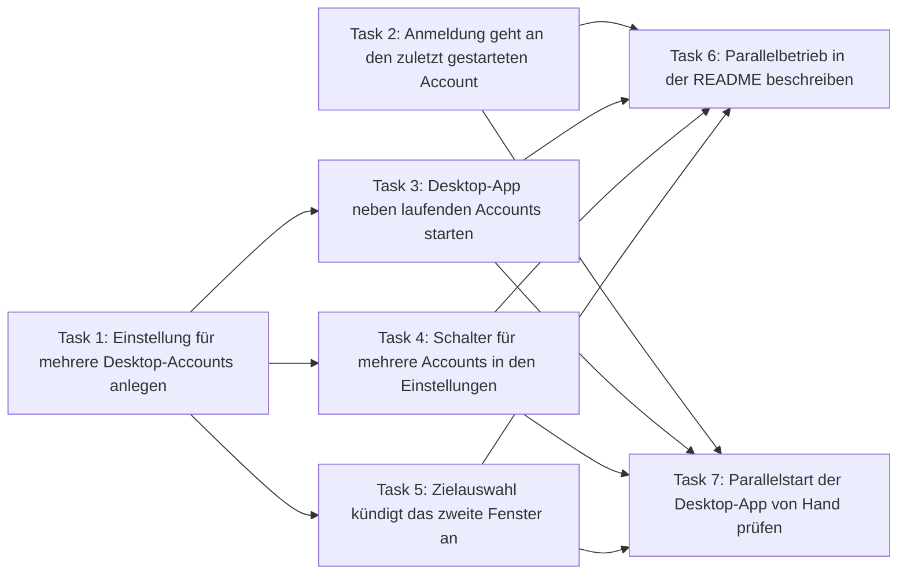

# Mehrere Accounts gleichzeitig in der Desktop-App – Implementation Plan

> **For agentic workers:** REQUIRED SUB-SKILL: Use superpowers:subagent-driven-development (recommended) or superpowers:executing-plans to implement this plan task-by-task. Steps use checkbox (`- [ ]`) syntax for tracking.

**Goal:** Die Desktop-App (Claude Desktop, ChatGPT) kann mit mehreren Accounts gleichzeitig laufen, wenn die Einstellung „Mehrere Accounts gleichzeitig öffnen“ an ist; eine Anmeldung über den Browser geht an den zuletzt gestarteten Account.

**Architecture:** Die Einstellung `AppSettings.AllowParallelDesktop` (Standard aus) erreicht Core über einen `Func<bool>` im Konstruktor von `DesktopLaunchService`. Ist sie an, meldet die Prüfung vor dem Start keinen Konflikt und der Start beendet nichts; `IDesktopLauncher` bleibt unverändert. `DesktopLoginRedirector` hält je Anbieter höchstens eine Anmelde-Überwachung, die neueste gewinnt.

**Tech Stack:** .NET 10, C#, Avalonia 11, CommunityToolkit.Mvvm; Tests mit xunit v3 und Shouldly.

**Spec:** `docs/superpowers/specs/2026-11-12-parallel-desktop-design.md` · **Tickets:** MCA-0001 (Task 1), MCA-0002 (Task 2), MCA-0003 (Task 3), MCA-0004 (Task 4), MCA-0005 (Task 5), MCA-0006 (Task 6), MCA-0007 (Task 7)

## Global Constraints

- `TreatWarningsAsErrors` ist an: `dotnet build MCACC.slnx` muss mit „0 Warnung(en)“ und „0 Fehler“ enden.
- Keine neuen NuGet-Pakete.
- Nur die unter „Dateien“ genannten Dateien ändern. Andere Aufgaben dieser Funktion laufen gleichzeitig in eigenen Worktrees; jede weitere Datei führt zu Merge-Konflikten.
- Code, Kommentare und XML-Doku auf Englisch, kurz, mit dem Grund statt der Beschreibung. Alle sichtbaren Texte auf Deutsch in `src/Mcacc.App/Localization/Texts*.cs`.
- File-scoped Namespaces, `var` wo möglich, 4 Leerzeichen, LF-Zeilenenden.
- Testnamen sind englische Sätze mit Unterstrichen. Tests nutzen xunit v3 (`TestContext.Current.CancellationToken`, in den Testklassen als `Ct`) und Shouldly.
- MCACC nicht starten (`dotnet run`, die EXE): Ein Start aus einer Claude-Sitzung kann laufende Instanzen von Claude Desktop beenden. Bauen und Tests reichen; die Tests arbeiten nur mit Fakes.
- Ein Commit je Aufgabe, Nachricht auf Englisch im Stil `feat(core): …`, `feat(app): …`, `docs: …`, am Ende die Co-Authored-By-Zeile des ausführenden Modells. Nicht pushen, nicht mergen.
- Die Ausgaben von `dotnet` sind auf diesem Rechner deutsch („Bestanden!“, „Fehler: 0“, „erfolgreich: N“).

Testbefehle:

- Eine Testklasse in Core: `dotnet test tests/Mcacc.Core.Tests --filter "FullyQualifiedName~<Klasse>"`
- Eine Testklasse der App: `dotnet test tests/Mcacc.App.Tests --filter "FullyQualifiedName~<Klasse>"`
- Alles bauen: `dotnet build MCACC.slnx`
- Alles testen: `dotnet test MCACC.slnx` – drei Testprojekte, jedes endet mit „Bestanden!“ und „Fehler: 0“; übersprungene Tests (Screenshots, plattformgebundene) sind normal.

## Dateien und Zuständigkeiten

Jede Datei gehört genau einer Aufgabe. Das ist die Voraussetzung dafür, dass die Aufgaben einer Welle gleichzeitig in eigenen Worktrees laufen können, ohne sich beim Mergen zu begegnen.

| Datei | Aufgabe | Wofür |
|---|---|---|
| `src/Mcacc.Core/Model/AppSettings.cs` | Task 1 | gespeicherte Einstellung `AllowParallelDesktop` |
| `tests/Mcacc.Core.Tests/Model/AppSettingsTests.cs` | Task 1 | Standardwert der Einstellung |
| `tests/Mcacc.Core.Tests/Config/McaccJsonContextTests.cs` | Task 1 | Schreiben und Lesen von `allowParallelDesktop` |
| `src/Mcacc.Core/Desktop/DesktopRedirectOutcome.cs` | Task 2 | Ergebnis `Superseded` |
| `src/Mcacc.Core/Abstractions/IDesktopLoginRedirector.cs` | Task 2 | Schnittstelle: `StopWatching` |
| `src/Mcacc.Core/Desktop/DesktopLoginRedirector.cs` | Task 2 | je Anbieter höchstens eine Überwachung |
| `src/Mcacc.App/Services/LaunchCoordinator.cs` | Task 2 | Standard-Start beendet die Überwachung; abgelöste räumt nicht auf |
| `tests/Mcacc.Core.Tests/Desktop/DesktopLoginRedirectorTests.cs` | Task 2 | ablösen und stoppen der Überwachung |
| `tests/Mcacc.App.Tests/TestSupport/Fakes.cs` | Task 2 | Test-Fake der Überwachung |
| `tests/Mcacc.App.Tests/Services/LaunchCoordinatorTests.cs` | Task 2 | Start des Standard-Accounts, abgelöste Überwachung |
| `src/Mcacc.Core/Desktop/DesktopLaunchService.cs` | Task 3 | Prüfung und Start: im Parallelbetrieb kein Konflikt, nichts beenden |
| `src/Mcacc.App/CompositionRoot.cs` | Task 3 | reicht die Einstellung als `Func<bool>` an den Startdienst |
| `tests/Mcacc.Core.Tests/Desktop/DesktopLaunchServiceTests.cs` | Task 3 | Prüfung und Start im Parallelbetrieb |
| `src/Mcacc.App/Localization/Texts.Parallel.cs` (neu) | Task 4 | Beschriftung und Hinweis des Schalters |
| `src/Mcacc.App/ViewModels/SettingsViewModel.cs` | Task 4 | Schalter laden und speichern |
| `src/Mcacc.App/Views/SettingsView.axaml` | Task 4 | Schalter auf der Einstellungsseite |
| `tests/Mcacc.App.Tests/ViewModels/SettingsViewModelTests.cs` | Task 4 | Schalter im ViewModel |
| `tests/Mcacc.App.Tests/Views/PageRenderTests.cs` | Task 4 | Anzahl der Schalter auf der Seite |
| `src/Mcacc.App/Localization/Texts.cs` | Task 5 | Untertitel der Zielauswahl im Parallelbetrieb |
| `src/Mcacc.App/ViewModels/TargetPickerViewModel.cs` | Task 5 | wählt den Untertitel nach der Einstellung |
| `tests/Mcacc.App.Tests/ViewModels/TargetPickerViewModelTests.cs` | Task 5 | Untertitel der Zielauswahl |
| `README.md` | Task 6 | Beschreibung für Nutzer |
| `docs/spike-results.md` | Task 7 | Befund der Prüfung von Hand (W4) |

Nicht angefasst werden `IDesktopLauncher`, `FakeDesktopLauncher`, `McaccJsonContext`, `DesktopInstanceDetector` und das Tray: Die Erkennung unterscheidet mehrere Instanzen schon heute, und der Startdienst entscheidet allein, ob eine fremde Instanz ein Konflikt ist.

## Reihenfolge und Parallelität

| Welle | Aufgaben (laufen gleichzeitig) | Start |
|---|---|---|
| 0 | Task 1 – Einstellung für mehrere Desktop-Accounts anlegen<br>Task 2 – Anmeldung geht an den zuletzt gestarteten Account | sofort |
| 1 | Task 3 – Desktop-App neben laufenden Accounts starten<br>Task 4 – Schalter für mehrere Accounts in den Einstellungen<br>Task 5 – Zielauswahl kündigt das zweite Fenster an | sobald Task 1 gemergt ist |
| 2 | Task 6 – Parallelbetrieb in der README beschreiben<br>Task 7 – Parallelstart der Desktop-App von Hand prüfen (von Hand) | sobald Task 2, Task 3, Task 4, Task 5 gemergt sind |



- Aufgaben derselben Welle haben keine Voraussetzung aufeinander und keine gemeinsame Datei.
- Eine Aufgabe startet erst, wenn ihre Voraussetzungen erledigt **und gemergt** sind; ihr Worktree entsteht dann aus dem Stand, der sie schon enthält.
- Jede Aufgabe ist für sich grün: Der Code aller Schritte wurde am 2026-11-12 gegen `be758f0` gebaut und getestet, jede Aufgabe einzeln auf ihrer Basis (Task 1; Task 2; Task 1 mit je einer der Tasks 3, 4, 5) und alle zusammen, jeweils mit 0 Warnungen und ohne fehlgeschlagenen Test.
- Die Tasks 3 bis 5 ergeben erst zusammen den Parallelbetrieb. Bis alle drei gemergt sind, kann der Schalter schon da sein, ohne dass der Start ihm folgt; deshalb bleibt die Einstellung standardmäßig aus, und README und Handprüfung warten auf alle.

---

### Task 1: Einstellung für mehrere Desktop-Accounts anlegen

**Welle:** 0 · **Voraussetzung:** keine · **Aufwand:** klein · **Ticket:** MCA-0001

MCACC bekommt die gespeicherte Einstellung, ob eine Desktop-App mit mehreren Accounts gleichzeitig laufen darf. Sie ist standardmäßig aus und steht als `allowParallelDesktop` in der `config.json`; eine Konfiguration ohne den Schlüssel liest sich als „aus“.
Die Einstellung ändert noch kein Verhalten. Sie ist die Grundlage für den Start neben laufenden Accounts, den Schalter in den Einstellungen und den Hinweis auf der Zielauswahl (FR-001 der Spec).

**Abnahme:**

- `new AppSettings().AllowParallelDesktop` ist `false`; eine Konfiguration mit `"allowParallelDesktop": true` liest sich als `true` und wird genauso wieder geschrieben; Standard-Einstellungen schreiben `"allowParallelDesktop": false` direkt hinter `"launchAtLogin": true`; `{ "version": 1, "accounts": [], "settings": { "closeAfterLaunch": false } }` liest sich mit `AllowParallelDesktop == false`
- `AppSettingsTests` (2 Tests) und `McaccJsonContextTests` (16 Tests) sind grün, `dotnet build MCACC.slnx` endet ohne Warnung (FR-001)

**Files:**
- Modify: `src/Mcacc.Core/Model/AppSettings.cs`
- Test: `tests/Mcacc.Core.Tests/Model/AppSettingsTests.cs`
- Test: `tests/Mcacc.Core.Tests/Config/McaccJsonContextTests.cs`

**Interfaces:**
- Consumes: nichts
- Produces: `AppSettings.AllowParallelDesktop` (`bool`, Standard `false`, letzter Parameter des Records `AppSettings`, JSON-Schlüssel `allowParallelDesktop`)

- [ ] **Step 1: Tests für Standardwert und JSON schreiben**

In `tests/Mcacc.Core.Tests/Model/AppSettingsTests.cs` als letzten Test der Klasse `AppSettingsTests` anfügen:

```csharp
    [Fact]
    public void Several_accounts_side_by_side_are_off_by_default()
    {
        new AppSettings().AllowParallelDesktop.ShouldBeFalse();
    }
```

In `tests/Mcacc.Core.Tests/Config/McaccJsonContextTests.cs` vier Stellen ändern und einen Test ergänzen.

1. Konstante `FullJson`, Ende des Blocks `"settings"`. Vorher:

```csharp
            "launchAtLogin": false
          }
```

Nachher:

```csharp
            "launchAtLogin": false,
            "allowParallelDesktop": true
          }
```

2. Feld `FullConfig`, letzte Zeile. Vorher `LaunchAtLogin: false));`, nachher:

```csharp
            LaunchAtLogin: false,
            AllowParallelDesktop: true));
```

3. In den Tests `Omits_null_values` und `Unknown_top_level_fields_survive_a_round_trip` steht im erwarteten JSON je einmal die Zeile `"launchAtLogin": true` als letzte der Einstellungen. Beide Male daraus machen (Einrückung der Stelle beibehalten):

```csharp
                "launchAtLogin": true,
                "allowParallelDesktop": false
```

4. Direkt hinter dem Test `A_config_without_launch_at_login_starts_at_login` einfügen:

```csharp
    [Fact]
    public void A_config_without_parallel_desktop_keeps_one_account_at_a_time()
    {
        Deserialize("""{ "version": 1, "accounts": [], "settings": { "closeAfterLaunch": false } }""")
            .Settings.AllowParallelDesktop.ShouldBeFalse();
    }
```

- [ ] **Step 2: Tests ausführen, müssen fehlschlagen**

Befehl: `dotnet test tests/Mcacc.Core.Tests --filter "FullyQualifiedName~AppSettingsTests"`
Erwartet: Der Build bricht mit Compilerfehlern ab (CS1061 und CS1739), weil `AppSettings` noch kein `AllowParallelDesktop` kennt.

- [ ] **Step 3: Einstellung im Record ergänzen**

In `src/Mcacc.Core/Model/AppSettings.cs` den Parameter ans Ende des Records hängen. Vorher:

```csharp
    bool LaunchAtLogin = true);
```

Nachher:

```csharp
    bool LaunchAtLogin = true,
    bool AllowParallelDesktop = false);
```

Über dem Record, direkt hinter dem Kommentar `<param name="LaunchAtLogin">…</param>`, diese Zeilen einfügen:

```csharp
/// <param name="AllowParallelDesktop">
/// A desktop app may run with several accounts side by side. Off, a start quits the instance of another account
/// after asking; that stays the default, because the apps are built to run once.
/// </param>
```

`McaccJsonContext` braucht keine Änderung: Der Quellgenerator übernimmt die neue Eigenschaft, der Name wird durch die camelCase-Regel zu `allowParallelDesktop`.

- [ ] **Step 4: Tests ausführen, müssen bestehen**

Befehl: `dotnet test tests/Mcacc.Core.Tests --filter "FullyQualifiedName~AppSettingsTests"`
Erwartet: „Bestanden!“, Fehler: 0, erfolgreich: 2

Befehl: `dotnet test tests/Mcacc.Core.Tests --filter "FullyQualifiedName~McaccJsonContextTests"`
Erwartet: „Bestanden!“, Fehler: 0, erfolgreich: 16

- [ ] **Step 5: Alles bauen und testen**

Befehl: `dotnet build MCACC.slnx`
Erwartet: „0 Warnung(en)“ und „0 Fehler“

Befehl: `dotnet test MCACC.slnx`
Erwartet: Alle drei Testprojekte enden mit „Bestanden!“ und „Fehler: 0“; übersprungene Tests sind normal.

- [ ] **Step 6: Committen**

Befehl: `git add src/Mcacc.Core/Model/AppSettings.cs tests/Mcacc.Core.Tests/Model/AppSettingsTests.cs tests/Mcacc.Core.Tests/Config/McaccJsonContextTests.cs`, danach `git commit` mit dieser Nachricht (am Ende die Co-Authored-By-Zeile des ausführenden Modells):

```text
feat(core): add the setting for several desktop accounts side by side
```

---

### Task 2: Anmeldung geht an den zuletzt gestarteten Account

**Welle:** 0 · **Voraussetzung:** keine · **Aufwand:** standard · **Ticket:** MCA-0002

Eine Anmeldung über den Browser kommt als `claude://`-Adresse zurück und nennt keinen Account. MCACC überwacht deshalb nach dem Start eines Profil-Accounts bis zu drei Minuten lang, ob so eine Anmeldung im falschen Profil ankommt, und übergibt sie dem gestarteten Account. Laufen zwei solche Überwachungen gleichzeitig, streiten sie um dieselbe Anmeldung.
Künftig gibt es je Anbieter höchstens eine Überwachung: Der Account, der zuletzt gestartet wurde, bekommt die Anmeldung. Eine ältere Überwachung endet, ohne etwas zu beenden oder zu starten, und räumt den Hinweis des neueren Starts nicht weg. Ein Start des Standard-Accounts beendet die laufende Überwachung, weil die Anmeldung dann von selbst im Standardprofil landet (FR-007, FR-008, FR-009, US3).

**Abnahme:**

- Startet während einer Überwachung für „Privat“ eine für „Arbeit“, endet die für „Privat“ mit `DesktopRedirectOutcome.Superseded`; die Anmeldung wird genau einmal beendet und genau einmal mit dem Datenordner von „Arbeit“ neu gestartet, Ergebnis dort `Redirected`
- Startet stattdessen eine Überwachung für den Standard-Account, endet sie mit `NotNeeded`, die für „Privat“ mit `Superseded`, und nichts wird beendet oder gestartet
- `StopWatching(ProviderKind.Claude)` während einer Claude-Überwachung liefert `true` und beendet sie mit `Superseded`; `StopWatching(ProviderKind.Codex)` lässt sie weiterlaufen (`Redirected`); ohne laufende Überwachung und nach deren Ende liefert `StopWatching` `false`
- Ein Start des Standard-Accounts ruft `StopWatching(ProviderKind.Claude)` auf; lief eine Überwachung, ist der Banner danach leer, lief keine, bleibt ein vorhandener Banner stehen
- Endet die Überwachung eines Profil-Accounts mit `Superseded`, bleibt der Hinweis `Texts.HintLoginWatch` stehen und das Fenster wird nicht ausgeblendet
- `DesktopLoginRedirectorTests` (20 Tests) und `LaunchCoordinatorTests` (11 Tests) sind grün, `dotnet build MCACC.slnx` endet ohne Warnung (FR-007, FR-008, FR-009; US3 Szenario 1 und 2)

**Files:**
- Modify: `src/Mcacc.Core/Desktop/DesktopRedirectOutcome.cs`
- Modify: `src/Mcacc.Core/Abstractions/IDesktopLoginRedirector.cs`
- Modify: `src/Mcacc.Core/Desktop/DesktopLoginRedirector.cs`
- Modify: `src/Mcacc.App/Services/LaunchCoordinator.cs`
- Test: `tests/Mcacc.Core.Tests/Desktop/DesktopLoginRedirectorTests.cs`
- Test: `tests/Mcacc.App.Tests/TestSupport/Fakes.cs`
- Test: `tests/Mcacc.App.Tests/Services/LaunchCoordinatorTests.cs`

**Interfaces:**
- Consumes: nichts
- Produces: `DesktopRedirectOutcome.Superseded`; `bool IDesktopLoginRedirector.StopWatching(ProviderKind provider)`; im Test-Fake `FakeLoginRedirector.Stopped` (`List<ProviderKind>`) und `FakeLoginRedirector.WasWatching` (`bool`)

- [ ] **Step 1: Tests für die Überwachung in Core schreiben**

Alles in `tests/Mcacc.Core.Tests/Desktop/DesktopLoginRedirectorTests.cs`.

1. Hinter dem Feld `Privat` einen dritten Account anlegen:

```csharp
    private static readonly Account Arbeit = new("arbeit", "Arbeit", "#788C5D", IsDefault: false);
```

2. In der privaten Klasse `FakeDetector` hinter der Eigenschaft `FailNext` einfügen:

```csharp

        /// <summary>Runs inside every detection with its number, to start or stop something while a watch looks.</summary>
        public Action<int>? OnDetect { get; set; }
```

3. Die Methode `FakeDetector.DetectAsync` ersetzen. Sie ruft neu `OnDetect` auf und läuft unter einer Sperre, weil zwei Überwachungen aus verschiedenen Threads schauen:

```csharp
        public Task<IReadOnlyList<DesktopInstance>> DetectAsync(ProviderDescriptor provider, CancellationToken ct)
        {
            // Two watches look from different threads once one of them was started from OnDetect.
            lock (_snapshots)
            {
                Calls++;
                OnDetect?.Invoke(Calls);
                if (FailNext > 0)
                {
                    FailNext--;
                    throw new TimeoutException("WMI did not answer within three seconds.");
                }

                if (_snapshots.TryDequeue(out var next))
                {
                    _current = next;
                }

                return Task.FromResult(_current);
            }
        }
```

4. Diese fünf Tests hinter den letzten vorhandenen Test (`A_canceled_watch_hands_nothing_over`) setzen, vor die private Klasse `FakeLocator`:

```csharp
    [Fact]
    public async Task A_newer_watch_takes_over_and_the_older_one_hands_nothing_over()
    {
        var redirector = Redirector();
        Task<DesktopRedirectOutcome>? newer = null;
        _detector.Script([TargetInstance, StrayLogin]);
        _detector.OnDetect = call =>
        {
            if (call == 1)
            {
                newer = redirector.WatchAsync(Arbeit, Ct);
            }
        };

        var older = await redirector.WatchAsync(Privat, Ct);

        older.ShouldBe(DesktopRedirectOutcome.Superseded);
        (await newer.ShouldNotBeNull()).ShouldBe(DesktopRedirectOutcome.Redirected);
        _terminator.Quits.ShouldBe([(StrayLogin, TimeSpan.Zero)]);
        _runner.Started.ShouldHaveSingleItem().ShouldBeEquivalentTo(
            DesktopLaunchPlanner.PlanWindows(Msix, ResolverFor(Windows).Resolve(Arbeit), Windows.HomeDir, LoginUrl));
    }

    [Fact]
    public async Task A_start_that_needs_no_watch_still_ends_the_one_before_it()
    {
        var redirector = Redirector();
        Task<DesktopRedirectOutcome>? newer = null;
        _detector.Script([TargetInstance, StrayLogin]);
        _detector.OnDetect = call =>
        {
            if (call == 1)
            {
                newer = redirector.WatchAsync(Standard, Ct);
            }
        };

        (await redirector.WatchAsync(Privat, Ct)).ShouldBe(DesktopRedirectOutcome.Superseded);
        (await newer.ShouldNotBeNull()).ShouldBe(DesktopRedirectOutcome.NotNeeded);
        _terminator.Quits.ShouldBeEmpty();
        _runner.Started.ShouldBeEmpty();
    }

    [Fact]
    public async Task Stopping_ends_a_running_watch_before_it_hands_anything_over()
    {
        var redirector = Redirector();
        var stopped = false;
        _detector.Script([TargetInstance, StrayLogin]);
        _detector.OnDetect = call =>
        {
            if (call == 1)
            {
                stopped = redirector.StopWatching(ProviderKind.Claude);
            }
        };

        var outcome = await redirector.WatchAsync(Privat, Ct);

        outcome.ShouldBe(DesktopRedirectOutcome.Superseded);
        stopped.ShouldBeTrue();
        _terminator.Quits.ShouldBeEmpty();
        _runner.Started.ShouldBeEmpty();
    }

    [Fact]
    public async Task Stopping_another_provider_leaves_the_watch_alone()
    {
        var redirector = Redirector();
        _detector.Script([TargetInstance, StrayLogin]);
        _detector.OnDetect = _ => redirector.StopWatching(ProviderKind.Codex);

        (await redirector.WatchAsync(Privat, Ct)).ShouldBe(DesktopRedirectOutcome.Redirected);
    }

    [Fact]
    public async Task Without_a_running_watch_there_is_nothing_to_stop()
    {
        var redirector = Redirector();
        redirector.StopWatching(ProviderKind.Claude).ShouldBeFalse();
        _detector.Script([TargetInstance, StrayLogin]);

        await redirector.WatchAsync(Privat, Ct);

        redirector.StopWatching(ProviderKind.Claude).ShouldBeFalse();
    }
```

Die Testuhr `FakeTimeProvider` feuert Timer sofort, aber auf dem Thread-Pool. `OnDetect` läuft deshalb mitten im ersten Blick der älteren Überwachung; die neuere kommt erst danach an die Reihe, weil sie an der Sperre des `FakeDetector` wartet.

- [ ] **Step 2: Core-Tests ausführen, müssen fehlschlagen**

Befehl: `dotnet test tests/Mcacc.Core.Tests --filter "FullyQualifiedName~DesktopLoginRedirectorTests"`
Erwartet: Der Build bricht mit Compilerfehlern ab (CS0117 und CS1061), weil es `DesktopRedirectOutcome.Superseded` und `StopWatching` noch nicht gibt.

- [ ] **Step 3: Ergebnis und Schnittstelle erweitern**

In `src/Mcacc.Core/Desktop/DesktopRedirectOutcome.cs` hinter dem Wert `Failed` (mit einer Leerzeile davor) einfügen:

```csharp
    /// <summary>A newer start took the watch over, or it was stopped; this one handed nothing over.</summary>
    Superseded,
```

In `src/Mcacc.Core/Abstractions/IDesktopLoginRedirector.cs` den Kommentar von `WatchAsync` erweitern und die neue Methode anfügen. Vorher:

```csharp
    /// <summary>Watches for a login that the operating system sends to the wrong profile and hands it to
    /// <paramref name="target"/>. Returns once the login is through, Claude Desktop is gone, or the window passes.</summary>
    Task<DesktopRedirectOutcome> WatchAsync(Account target, CancellationToken ct);
```

Nachher:

```csharp
    /// <summary>Watches for a login that the operating system sends to the wrong profile and hands it to
    /// <paramref name="target"/>. Returns once the login is through, Claude Desktop is gone, or the window passes.
    /// A login coming back names no account, so only the start made last can get it: a new watch ends the one of
    /// the same provider before it.</summary>
    Task<DesktopRedirectOutcome> WatchAsync(Account target, CancellationToken ct);

    /// <summary>Ends the watch of that provider, for a start that needs none itself: a login coming back now is
    /// its own.</summary>
    /// <returns>Whether a watch was running.</returns>
    bool StopWatching(ProviderKind provider);
```

- [ ] **Step 4: Je Anbieter nur eine Überwachung zulassen**

Alles in `src/Mcacc.Core/Desktop/DesktopLoginRedirector.cs`.

1. Ganz oben `using System.Collections.Concurrent;` als erste `using`-Zeile ergänzen.

2. Die bisherige Methode `WatchAsync` wird zu `RunWatchAsync`; davor kommen das Verzeichnis der laufenden Überwachungen, die neue `WatchAsync` und `StopWatching`. Vorher:

```csharp
    private readonly TimeProvider _time = time ?? TimeProvider.System;

    /// <exception cref="PlatformNotSupportedException">Claude Desktop is installed on neither Windows nor macOS.</exception>
    public async Task<DesktopRedirectOutcome> WatchAsync(Account target, CancellationToken ct)
    {
        var paths = resolver.Resolve(target);
```

Nachher:

```csharp
    private readonly TimeProvider _time = time ?? TimeProvider.System;

    /// <summary>The running watch of each provider. A newer one replaces it here, and the older one sees that at its next look.</summary>
    private readonly ConcurrentDictionary<ProviderKind, object> _watches = new();

    /// <exception cref="PlatformNotSupportedException">Claude Desktop is installed on neither Windows nor macOS.</exception>
    public async Task<DesktopRedirectOutcome> WatchAsync(Account target, CancellationToken ct)
    {
        // A login coming back names no account, so it can only go to the start made last: this watch ends the one
        // before it, even when it turns out to need none itself.
        var watch = new object();
        _watches[target.Provider] = watch;
        try
        {
            return await RunWatchAsync(target, watch, ct).ConfigureAwait(false);
        }
        finally
        {
            _watches.TryRemove(KeyValuePair.Create(target.Provider, watch));
        }
    }

    public bool StopWatching(ProviderKind provider) => _watches.TryRemove(provider, out _);

    private async Task<DesktopRedirectOutcome> RunWatchAsync(Account target, object watch, CancellationToken ct)
    {
        var paths = resolver.Resolve(target);
```

Der Rest des bisherigen Rumpfs bleibt in `RunWatchAsync`, bis auf die Stelle in Punkt 3. `TryRemove` mit Schlüssel und Wert entfernt den Eintrag nur, wenn er noch dieser Überwachung gehört; eine neuere bleibt so stehen.

3. In der Schleife von `RunWatchAsync` nach jedem Blick fragen, ob die Überwachung noch die aktuelle ist. Vorher:

```csharp
            await Task.Delay(PollInterval, _time, ct).ConfigureAwait(false);
            if (await DetectAsync(paths.Provider, ct).ConfigureAwait(false) is not { } instances)
            {
                continue;
            }
```

Nachher:

```csharp
            await Task.Delay(PollInterval, _time, ct).ConfigureAwait(false);
            var instances = await DetectAsync(paths.Provider, ct).ConfigureAwait(false);

            // Asked after the look, not before it: a snapshot taken while a newer watch began is not this one's to act on.
            if (!IsCurrent(target.Provider, watch))
            {
                return DesktopRedirectOutcome.Superseded;
            }

            if (instances is null)
            {
                continue;
            }
```

4. Direkt vor der privaten Methode `DetectAsync` (über ihrem Kommentar `/// <returns>Null when this snapshot could not be taken; the next one may work.</returns>`) einfügen:

```csharp
    private bool IsCurrent(ProviderKind provider, object watch) =>
        _watches.TryGetValue(provider, out var current) && ReferenceEquals(current, watch);

```

- [ ] **Step 5: Core-Tests ausführen, müssen bestehen**

Befehl: `dotnet test tests/Mcacc.Core.Tests --filter "FullyQualifiedName~DesktopLoginRedirectorTests"`
Erwartet: „Bestanden!“, Fehler: 0, erfolgreich: 20

- [ ] **Step 6: Test-Fake der App erweitern und Tests für den Start schreiben**

In `tests/Mcacc.App.Tests/TestSupport/Fakes.cs` in der Klasse `FakeLoginRedirector` hinter der Eigenschaft `Gate` einfügen (ohne das baut das Testprojekt nicht mehr, weil die Schnittstelle gewachsen ist):

```csharp

    public List<ProviderKind> Stopped { get; } = [];

    /// <summary>What <see cref="StopWatching"/> answers: whether a watch was still running.</summary>
    public bool WasWatching { get; set; }

    public bool StopWatching(ProviderKind provider)
    {
        Stopped.Add(provider);
        return WasWatching;
    }
```

In `tests/Mcacc.App.Tests/Services/LaunchCoordinatorTests.cs` diese drei Tests einfügen, direkt vor dem Test `The_login_watch_runs_without_bringing_the_window_up`:

```csharp
    [Fact]
    public async Task A_default_start_ends_a_watch_that_still_runs_and_takes_its_hint_down()
    {
        _services.Redirect.WasWatching = true;
        _services.Window.ShowError(Texts.HintLoginWatch);

        await Launcher.LaunchDesktopAsync(Standard);

        _services.Redirect.Stopped.ShouldBe([ProviderKind.Claude]);
        _services.Redirect.Watched.ShouldBeEmpty();
        _services.Window.ErrorBanner.ShouldBeNull();
    }

    [Fact]
    public async Task A_default_start_without_a_running_watch_leaves_the_banner_alone()
    {
        _services.Window.ShowError(Texts.ErrorConfigReadOnly);

        await Launcher.LaunchDesktopAsync(Standard);

        _services.Redirect.Stopped.ShouldBe([ProviderKind.Claude]);
        _services.Window.ErrorBanner.ShouldBe(Texts.ErrorConfigReadOnly);
    }

    [Fact]
    public async Task A_superseded_watch_leaves_the_hint_and_the_window_to_the_newer_start()
    {
        _services.Redirect.Outcome = DesktopRedirectOutcome.Superseded;

        await Launcher.LaunchDesktopAsync(Privat);

        _services.Window.ErrorBanner.ShouldBe(Texts.HintLoginWatch);
        _services.Lifetime.Hides.ShouldBe(0);
    }
```

- [ ] **Step 7: App-Tests ausführen, müssen fehlschlagen**

Befehl: `dotnet test tests/Mcacc.App.Tests --filter "FullyQualifiedName~LaunchCoordinatorTests"`
Erwartet: „Fehler!“, Fehler: 3, erfolgreich: 8. Die drei neuen Tests schlagen fehl: `Stopped` ist leer statt `[Claude]`, und nach `Superseded` ist der Banner leer statt `Texts.HintLoginWatch`.

- [ ] **Step 8: Start des Standard-Accounts und abgelöste Überwachung behandeln**

Alles in `src/Mcacc.App/Services/LaunchCoordinator.cs`.

1. In `LaunchDesktopAsync`, im Zweig `case DesktopLaunchOutcome.Launched:`. Vorher:

```csharp
                if (account.IsDefault)
                {
                    await FinishAsync(account, LaunchTarget.Desktop, autoClose: true).ConfigureAwait(true);
                    return;
                }
```

Nachher:

```csharp
                if (account.IsDefault)
                {
                    // A login coming back now lands in the default profile by itself. A watch still running for
                    // another account would take it away, so it ends here, and its hint goes with it.
                    if (services.Redirect.StopWatching(account.Provider))
                    {
                        services.Shell.ClearError();
                    }

                    await FinishAsync(account, LaunchTarget.Desktop, autoClose: true).ConfigureAwait(true);
                    return;
                }
```

2. In `WatchLoginAsync` direkt hinter dem Block `if (outcome == DesktopRedirectOutcome.Failed) { … return; }` einfügen, mit einer Leerzeile davor:

```csharp
        if (outcome == DesktopRedirectOutcome.Superseded)
        {
            // A newer start took the watch over; the hint and the window are its to handle now.
            return;
        }
```

Der Banner wird nur geleert, wenn wirklich eine Überwachung lief; sonst würde ein Start des Standard-Accounts fremde Meldungen wegräumen.

- [ ] **Step 9: App-Tests ausführen, müssen bestehen**

Befehl: `dotnet test tests/Mcacc.App.Tests --filter "FullyQualifiedName~LaunchCoordinatorTests"`
Erwartet: „Bestanden!“, Fehler: 0, erfolgreich: 11

- [ ] **Step 10: Alles bauen und testen**

Befehl: `dotnet build MCACC.slnx`
Erwartet: „0 Warnung(en)“ und „0 Fehler“

Befehl: `dotnet test MCACC.slnx`
Erwartet: Alle drei Testprojekte enden mit „Bestanden!“ und „Fehler: 0“; übersprungene Tests sind normal.

- [ ] **Step 11: Committen**

Befehl: `git add src/Mcacc.Core/Desktop/DesktopRedirectOutcome.cs src/Mcacc.Core/Abstractions/IDesktopLoginRedirector.cs src/Mcacc.Core/Desktop/DesktopLoginRedirector.cs src/Mcacc.App/Services/LaunchCoordinator.cs tests/Mcacc.Core.Tests/Desktop/DesktopLoginRedirectorTests.cs tests/Mcacc.App.Tests/TestSupport/Fakes.cs tests/Mcacc.App.Tests/Services/LaunchCoordinatorTests.cs`, danach `git commit` mit dieser Nachricht (am Ende die Co-Authored-By-Zeile des ausführenden Modells):

```text
feat(core): give a returning login to the desktop account started last
```

---

### Task 3: Desktop-App neben laufenden Accounts starten

**Welle:** 1 · **Voraussetzung:** MCA-0001 „Einstellung für mehrere Desktop-Accounts anlegen“ · **Aufwand:** standard · **Ticket:** MCA-0003

Ist die Einstellung für mehrere Accounts an, beendet ein Start der Desktop-App keine Instanzen anderer Accounts mehr. Die Prüfung vor dem Start meldet „bereit“ statt eines Konflikts, und der Start legt nach 500 ms mit dem Datenordner des gewählten Accounts los, ohne die laufenden Prozesse abzufragen.
Ist die Einstellung aus, bleibt alles wie bisher: Rückfrage, beenden, neu starten. Die Einstellung wird bei jeder Prüfung und jedem Start neu gelesen, damit Umschalten ohne Neustart von MCACC wirkt (FR-002, FR-003, FR-004, US1).

**Abnahme:**

- Einstellung an, es laufen der Standard-Account und ein unbekanntes Profil: `PrepareAsync(Privat, …)` liefert `DesktopLaunchCheck.Ready`; läuft zusätzlich „Privat“ selbst, liefert es `RunningSameAccount`
- Einstellung an, der Standard-Account läuft: `LaunchAsync(Privat, …, quitConflicts: false)` und `quitConflicts: true` liefern beide `Launched`, beenden nichts, der Start erfolgt 500 ms nach dem Aufruf mit dem Datenordner von „Privat“, und die Erkennung wird 0-mal aufgerufen
- Derselbe Dienst liefert mit ausgeschalteter Einstellung `ConflictNotResolved` und nach dem Einschalten `Launched`
- `DesktopLaunchServiceTests` (28 Tests) sind grün, alle bisherigen Tests unverändert; `dotnet build MCACC.slnx` endet ohne Warnung (FR-002, FR-003, FR-004; US1 Szenario 1 bis 3)

**Files:**
- Modify: `src/Mcacc.Core/Desktop/DesktopLaunchService.cs`
- Modify: `src/Mcacc.App/CompositionRoot.cs`
- Test: `tests/Mcacc.Core.Tests/Desktop/DesktopLaunchServiceTests.cs`

**Interfaces:**
- Consumes: `AppSettings.AllowParallelDesktop` (`bool`, Standard `false`) aus dem Ticket „Einstellung für mehrere Desktop-Accounts anlegen“; in der App erreichbar als `accounts.Config.Settings.AllowParallelDesktop` (`accounts` ist die `AccountService`-Variable in `CompositionRoot`)
- Produces: Konstruktor von `DesktopLaunchService` mit dem neuen letzten, optionalen Parameter `Func<bool>? allowParallel = null`; `IDesktopLauncher` bleibt unverändert

- [ ] **Step 1: Testhelfer erweitern und Tests schreiben**

Alles in `tests/Mcacc.Core.Tests/Desktop/DesktopLaunchServiceTests.cs`.

1. Hinter dem Feld `private DateTimeOffset? _startedAt;` einfügen:

```csharp
    private bool _allowParallel;
```

2. Im Helfer `Service(...)` endet der Aufruf `new DesktopLaunchService(` bisher mit `platform,` und `_time);`. Daraus machen:

```csharp
            platform,
            _time,
            () => _allowParallel);
```

3. Diese fünf Tests hinter den letzten vorhandenen Test setzen, vor die private Klasse `FakeLocator`:

```csharp
    [Fact]
    public async Task Side_by_side_prepare_is_ready_although_other_accounts_run()
    {
        _allowParallel = true;
        _detector.Script([StandardInstance, UnknownInstance]);

        (await Service().PrepareAsync(Privat, Accounts, Ct)).ShouldBe(new DesktopLaunchCheck.Ready());
    }

    [Fact]
    public async Task Side_by_side_prepare_still_reports_the_same_account_running()
    {
        _allowParallel = true;
        _detector.Script([StandardInstance, PrivatInstance]);

        (await Service().PrepareAsync(Privat, Accounts, Ct)).ShouldBe(new DesktopLaunchCheck.RunningSameAccount());
    }

    [Fact]
    public async Task Side_by_side_launch_starts_next_to_another_account_and_quits_nothing()
    {
        _allowParallel = true;
        _detector.Script([StandardInstance]);

        var outcome = await Service().LaunchAsync(Privat, Accounts, quitConflicts: false, Ct);

        outcome.ShouldBe(DesktopLaunchOutcome.Launched);
        _terminator.Quits.ShouldBeEmpty();
        _runner.Started.ShouldHaveSingleItem().ShouldBeEquivalentTo(
            DesktopLaunchPlanner.PlanWindows(Msix, ResolverFor(Windows).Resolve(Privat), Windows.HomeDir));
        (_startedAt - Start).ShouldBe(TimeSpan.FromMilliseconds(500));
    }

    [Fact]
    public async Task Side_by_side_launch_quits_nothing_even_with_permission_and_does_not_wait_on_a_detection()
    {
        _allowParallel = true;
        _detector.Script([StandardInstance]);

        var outcome = await Service().LaunchAsync(Privat, Accounts, quitConflicts: true, Ct);

        outcome.ShouldBe(DesktopLaunchOutcome.Launched);
        _terminator.Quits.ShouldBeEmpty();
        _detector.Calls.ShouldBe(0);
    }

    [Fact]
    public async Task The_switch_is_asked_at_every_start()
    {
        _detector.Script([StandardInstance]);
        var service = Service();

        (await service.LaunchAsync(Privat, Accounts, quitConflicts: false, Ct))
            .ShouldBe(DesktopLaunchOutcome.ConflictNotResolved);

        _allowParallel = true;

        (await service.LaunchAsync(Privat, Accounts, quitConflicts: false, Ct)).ShouldBe(DesktopLaunchOutcome.Launched);
    }
```

`StandardInstance`, `PrivatInstance`, `UnknownInstance`, `Privat`, `Accounts`, `Msix`, `Windows`, `Start`, `Ct`, `ResolverFor`, `_detector`, `_terminator` und `_runner` gibt es in der Testklasse schon.

- [ ] **Step 2: Tests ausführen, müssen fehlschlagen**

Befehl: `dotnet test tests/Mcacc.Core.Tests --filter "FullyQualifiedName~DesktopLaunchServiceTests"`
Erwartet: Der Build bricht mit einem Compilerfehler ab (CS1729), weil der Konstruktor von `DesktopLaunchService` noch kein neuntes Argument annimmt.

- [ ] **Step 3: Regel im Startdienst umsetzen**

Alles in `src/Mcacc.Core/Desktop/DesktopLaunchService.cs`.

1. Direkt über `public sealed class DesktopLaunchService(` einfügen (die Klasse hat bisher keinen Kommentar, es bleibt bei diesem einen `<param>`):

```csharp
/// <param name="allowParallel">
/// Asked at every check and start: whether instances of other accounts stay open next to the one being started.
/// Null keeps one account at a time.
/// </param>
```

2. Den letzten Konstruktorparameter erweitern. Vorher `TimeProvider? time = null) : IDesktopLauncher`, nachher:

```csharp
    TimeProvider? time = null,
    Func<bool>? allowParallel = null) : IDesktopLauncher
```

3. Hinter dem Feld `private readonly TimeProvider _time = time ?? TimeProvider.System;` einfügen:

```csharp

    /// <summary>Side by side, an instance of another account is no conflict: every profile holds its own lock.</summary>
    private bool AllowParallel => allowParallel?.Invoke() ?? false;
```

4. In `PrepareAsync` die Bedingung für den Konflikt erweitern. Vorher `if (conflicts.Count > 0)`, nachher:

```csharp
        if (conflicts.Count > 0 && !AllowParallel)
        {
            return new DesktopLaunchCheck.Conflict(conflicts);
        }
```

5. Den Kommentar zu `quitConflicts` über `LaunchAsync` ersetzen durch:

```csharp
    /// <param name="quitConflicts">
    /// Whether instances of other accounts may be quit; they are detected again first. Side by side nothing is quit,
    /// whatever this says.
    /// </param>
```

6. In `LaunchAsync` steht hinter `var plan = Plan(installation, resolver.Resolve(target));` die Erkennung mit der Konfliktbehandlung (von `var (conflicts, _) = await DetectAsync(…)` bis zum Ende des `if (conflicts.Count > 0)`-Blocks). Diesen Teil unverändert in ein `if (!AllowParallel)` einschließen, sodass er so aussieht:

```csharp
        var plan = Plan(installation, resolver.Resolve(target));

        // Side by side there is nothing to look for: whoever runs stays, so the start does not wait on a detection.
        if (!AllowParallel)
        {
            var (conflicts, _) = await DetectAsync(target, accounts, ct).ConfigureAwait(false);
            if (conflicts.Count > 0)
            {
                if (!quitConflicts)
                {
                    return DesktopLaunchOutcome.ConflictNotResolved;
                }

                var grace = platform.Os == OsKind.MacOS ? MacQuitGrace : WindowsQuitGrace;
                foreach (var conflict in conflicts)
                {
                    // Detection decides below whether the instance is gone, whatever the terminator reports.
                    await terminator.QuitAsync(conflict.Instance, grace, ct).ConfigureAwait(false);
                }

                if (!await WaitUntilNoConflictAsync(target, accounts, ct).ConfigureAwait(false))
                {
                    return DesktopLaunchOutcome.QuitFailed;
                }
            }
        }
```

Alles danach (die Wartezeit von 500 ms und `runner.Start(plan)`) bleibt, wie es ist.

- [ ] **Step 4: Tests ausführen, müssen bestehen**

Befehl: `dotnet test tests/Mcacc.Core.Tests --filter "FullyQualifiedName~DesktopLaunchServiceTests"`
Erwartet: „Bestanden!“, Fehler: 0, erfolgreich: 28

- [ ] **Step 5: Einstellung in der App anschließen**

In `src/Mcacc.App/CompositionRoot.cs` bekommt der Aufruf `new DesktopLaunchService(` ein weiteres, benanntes Argument. Vorher:

```csharp
                new DesktopInstanceMatcher(resolver, platform.Info.PathStyle),
                platform.Info),
            new DesktopLoginRedirector(
```

Nachher:

```csharp
                new DesktopInstanceMatcher(resolver, platform.Info.PathStyle),
                platform.Info,
                allowParallel: () => accounts.Config.Settings.AllowParallelDesktop),
            new DesktopLoginRedirector(
```

Der Delegat liest die Einstellung bei jedem Aufruf frisch; gespeichert wird nichts.

Befehl: `dotnet build MCACC.slnx`
Erwartet: „0 Warnung(en)“ und „0 Fehler“

- [ ] **Step 6: Alles testen**

Befehl: `dotnet test MCACC.slnx`
Erwartet: Alle drei Testprojekte enden mit „Bestanden!“ und „Fehler: 0“; übersprungene Tests sind normal.

- [ ] **Step 7: Committen**

Befehl: `git add src/Mcacc.Core/Desktop/DesktopLaunchService.cs src/Mcacc.App/CompositionRoot.cs tests/Mcacc.Core.Tests/Desktop/DesktopLaunchServiceTests.cs`, danach `git commit` mit dieser Nachricht (am Ende die Co-Authored-By-Zeile des ausführenden Modells):

```text
feat(core): start a desktop app next to running accounts when the setting allows it
```

---

### Task 4: Schalter für mehrere Accounts in den Einstellungen

**Welle:** 1 · **Voraussetzung:** MCA-0001 „Einstellung für mehrere Desktop-Accounts anlegen“ · **Aufwand:** standard · **Ticket:** MCA-0004

Die Einstellungsseite bekommt den Schalter „Mehrere Accounts gleichzeitig öffnen“ mit einem Hinweistext darunter. Er steht unter „Bei der Anmeldung starten“, zeigt den gespeicherten Wert und speichert beim Umschalten sofort.
Damit kann der Nutzer den Parallelbetrieb der Desktop-App selbst ein- und ausschalten (FR-005, US2 Szenario 1).

**Abnahme:**

- Die Seite zeigt drei Schalter statt zwei; der neue trägt die Beschriftung „Mehrere Accounts gleichzeitig öffnen“ und darunter einen Hinweis, der „eigenen Fenster“ enthält
- Ein neues `SettingsViewModel` hat `AllowParallelDesktop == false`; steht in der Konfiguration `true`, zeigt es `true`
- `AllowParallelDesktop = true` am ViewModel setzt `Accounts.Config.Settings.AllowParallelDesktop` auf `true`, `false` wieder auf `false`
- `SettingsViewModelTests` (24 Tests) und `PageRenderTests` (11 Tests) sind grün, `dotnet build MCACC.slnx` endet ohne Warnung (FR-005, US2 Szenario 1)

**Files:**
- Create: `src/Mcacc.App/Localization/Texts.Parallel.cs`
- Modify: `src/Mcacc.App/ViewModels/SettingsViewModel.cs`
- Modify: `src/Mcacc.App/Views/SettingsView.axaml`
- Test: `tests/Mcacc.App.Tests/ViewModels/SettingsViewModelTests.cs`
- Test: `tests/Mcacc.App.Tests/Views/PageRenderTests.cs`

**Interfaces:**
- Consumes: `AppSettings.AllowParallelDesktop` (`bool`, Standard `false`) aus dem Ticket „Einstellung für mehrere Desktop-Accounts anlegen“; gespeichert wird wie bei den anderen Schaltern über die vorhandene Methode `Save(settings => settings with { … })` des ViewModels
- Produces: `Texts.SettingsParallelDesktop` und `Texts.SettingsParallelDesktopHint` (`const string`, in der neuen Datei `Texts.Parallel.cs`); `SettingsViewModel.AllowParallelDesktop` (`bool`), `ParallelDesktopText` und `ParallelDesktopHint` (`string`)

- [ ] **Step 1: Tests für ViewModel und Seite schreiben**

In `tests/Mcacc.App.Tests/ViewModels/SettingsViewModelTests.cs` diese drei Tests einfügen, direkt vor dem Test `The_data_folder_is_the_mcacc_root`:

```csharp
    [Fact]
    public void Several_accounts_side_by_side_start_from_the_saved_setting()
    {
        Page().AllowParallelDesktop.ShouldBeFalse();

        _services.Accounts.UpdateSettings(settings => settings with { AllowParallelDesktop = true });

        Page().AllowParallelDesktop.ShouldBeTrue();
    }

    [Fact]
    public void Switching_several_accounts_side_by_side_saves_it()
    {
        var page = Page();

        page.AllowParallelDesktop = true;
        _services.Accounts.Config.Settings.AllowParallelDesktop.ShouldBeTrue();

        page.AllowParallelDesktop = false;
        _services.Accounts.Config.Settings.AllowParallelDesktop.ShouldBeFalse();
    }

    [Fact]
    public void The_switch_for_several_accounts_carries_its_german_label_and_hint()
    {
        var page = Page();

        page.ParallelDesktopText.ShouldBe("Mehrere Accounts gleichzeitig öffnen");
        page.ParallelDesktopHint.ShouldBe(Texts.SettingsParallelDesktopHint);
        page.ParallelDesktopHint.ShouldContain("eigenen Fenster");
    }
```

In `tests/Mcacc.App.Tests/Views/PageRenderTests.cs` zählt der Test `The_settings_page_renders_its_controls` die Schalter. Vorher:

```csharp
        window.GetVisualDescendants().OfType<ToggleSwitch>().Count().ShouldBe(2);
```

Nachher:

```csharp
        window.GetVisualDescendants().OfType<ToggleSwitch>().Count().ShouldBe(3);
```

- [ ] **Step 2: Tests ausführen, müssen fehlschlagen**

Befehl: `dotnet test tests/Mcacc.App.Tests --filter "FullyQualifiedName~SettingsViewModelTests"`
Erwartet: Der Build bricht mit Compilerfehlern ab (CS1061 und CS0117), weil `SettingsViewModel` noch kein `AllowParallelDesktop` und `Texts` noch kein `SettingsParallelDesktopHint` kennt.

- [ ] **Step 3: Texte in einer eigenen Datei anlegen**

Neue Datei `src/Mcacc.App/Localization/Texts.Parallel.cs` (die Klasse `Texts` ist `partial`; die Texte des Tray liegen genauso in `Texts.Tray.cs`):

```csharp
namespace Mcacc.App.Localization;

public static partial class Texts
{
    // Several accounts side by side
    public const string SettingsParallelDesktop = "Mehrere Accounts gleichzeitig öffnen";

    public const string SettingsParallelDesktopHint =
        "Läuft die Desktop-App schon mit einem anderen Account, bleibt sie offen, und der gewählte Account öffnet "
        + "sich in einem eigenen Fenster daneben. Ausgeschaltet wird sie nach Rückfrage beendet und neu gestartet.";
}
```

`src/Mcacc.App/Localization/Texts.cs` bleibt unberührt; daran arbeitet gleichzeitig ein anderes Ticket.

- [ ] **Step 4: ViewModel um den Schalter erweitern**

Alles in `src/Mcacc.App/ViewModels/SettingsViewModel.cs`, jeweils direkt neben dem Gegenstück für `LaunchAtLogin`.

1. Im Konstruktor hinter `LaunchAtLogin = settings.LaunchAtLogin;` (noch vor `_isLoading = false`) einfügen:

```csharp
        AllowParallelDesktop = settings.AllowParallelDesktop;
```

2. Hinter der Eigenschaft `LaunchAtLoginHint` einfügen:

```csharp

    public string ParallelDesktopText => Texts.SettingsParallelDesktop;

    public string ParallelDesktopHint => Texts.SettingsParallelDesktopHint;
```

3. Hinter der beobachtbaren Eigenschaft `LaunchAtLogin` einfügen:

```csharp

    [ObservableProperty]
    public partial bool AllowParallelDesktop { get; set; }
```

4. Zu den anderen `partial void On…Changed`-Methoden diese stellen (in der geprüften Fassung steht sie direkt vor dem `<summary>`, der mit „Reads the logs of every account through the stats index“ beginnt):

```csharp
    partial void OnAllowParallelDesktopChanged(bool value) =>
        Save(settings => settings with { AllowParallelDesktop = value });

```

`Save` überspringt das Speichern, solange der Konstruktor lädt (`_isLoading`); deshalb muss die Zuweisung aus Punkt 1 zwischen `_isLoading = true` und `_isLoading = false` stehen.

- [ ] **Step 5: Schalter in die Seite setzen**

In `src/Mcacc.App/Views/SettingsView.axaml` direkt hinter dem Block des Schalters `LaunchAtLogin` (er endet mit dem `TextBlock` für `LaunchAtLoginHint` und `</StackPanel>`) einfügen, mit einer Leerzeile davor:

```xml
      <StackPanel Spacing="2">
        <ToggleSwitch IsChecked="{Binding AllowParallelDesktop}"
                      OnContent="{Binding ParallelDesktopText}"
                      OffContent="{Binding ParallelDesktopText}" />
        <TextBlock Classes="caption muted" Text="{Binding ParallelDesktopHint}" TextWrapping="Wrap" />
      </StackPanel>
```

`OnContent` und `OffContent` tragen beide denselben Text, weil sonst das englische „On/Off“ von Fluent erscheint.

- [ ] **Step 6: Tests ausführen, müssen bestehen**

Befehl: `dotnet test tests/Mcacc.App.Tests --filter "FullyQualifiedName~SettingsViewModelTests"`
Erwartet: „Bestanden!“, Fehler: 0, erfolgreich: 24

Befehl: `dotnet test tests/Mcacc.App.Tests --filter "FullyQualifiedName~PageRenderTests"`
Erwartet: „Bestanden!“, Fehler: 0, erfolgreich: 11

- [ ] **Step 7: Alles bauen und testen**

Befehl: `dotnet build MCACC.slnx`
Erwartet: „0 Warnung(en)“ und „0 Fehler“

Befehl: `dotnet test MCACC.slnx`
Erwartet: Alle drei Testprojekte enden mit „Bestanden!“ und „Fehler: 0“; übersprungene Tests sind normal.

- [ ] **Step 8: Committen**

Befehl: `git add src/Mcacc.App/Localization/Texts.Parallel.cs src/Mcacc.App/ViewModels/SettingsViewModel.cs src/Mcacc.App/Views/SettingsView.axaml tests/Mcacc.App.Tests/ViewModels/SettingsViewModelTests.cs tests/Mcacc.App.Tests/Views/PageRenderTests.cs`, danach `git commit` mit dieser Nachricht (am Ende die Co-Authored-By-Zeile des ausführenden Modells):

```text
feat(app): add the switch for several desktop accounts to the settings
```

---

### Task 5: Zielauswahl kündigt das zweite Fenster an

**Welle:** 1 · **Voraussetzung:** MCA-0001 „Einstellung für mehrere Desktop-Accounts anlegen“ · **Aufwand:** klein · **Ticket:** MCA-0005

Die Seite „Was möchtest du öffnen?“ sagt im Untertitel, was ein Start mit einer schon laufenden Desktop-App eines anderen Accounts macht. Ist die Einstellung für mehrere Accounts an, steht dort, dass sich ein weiteres Fenster daneben öffnet; sonst bleibt der bisherige Satz zum Neustart nach Rückfrage.
So weiß der Nutzer vor dem Klick, ob seine laufende Instanz offen bleibt (FR-006, US2 Szenario 2).

**Abnahme:**

- Einstellung aus: Der Untertitel ist „Läuft Claude Desktop mit einem anderen Account, wird es nach Rückfrage neu gestartet.“
- Einstellung an: Der Untertitel ist „Läuft Claude Desktop schon mit einem anderen Account, öffnet sich ein weiteres Fenster daneben.“; bei einem Codex-Account beginnt er mit „Läuft ChatGPT schon“
- `TargetPickerViewModelTests` (34 Tests) sind grün, `dotnet build MCACC.slnx` endet ohne Warnung (FR-006, US2 Szenario 2)

**Files:**
- Modify: `src/Mcacc.App/Localization/Texts.cs`
- Modify: `src/Mcacc.App/ViewModels/TargetPickerViewModel.cs`
- Test: `tests/Mcacc.App.Tests/ViewModels/TargetPickerViewModelTests.cs`

**Interfaces:**
- Consumes: `AppSettings.AllowParallelDesktop` (`bool`, Standard `false`) aus dem Ticket „Einstellung für mehrere Desktop-Accounts anlegen“; im ViewModel erreichbar als `_services.Accounts.Config.Settings.AllowParallelDesktop`; vorhandene Methode `Texts.TargetDesktop(ProviderKind provider)` liefert „Claude Desktop“ bzw. „ChatGPT“
- Produces: `Texts.TargetPickerSubtitleParallel(ProviderKind provider)` (`string`)

- [ ] **Step 1: Tests für den Untertitel schreiben**

In `tests/Mcacc.App.Tests/ViewModels/TargetPickerViewModelTests.cs` diese drei Tests einfügen, direkt vor dem Test `The_code_tile_names_the_selected_terminal`:

```csharp
    [Fact]
    public void One_account_at_a_time_the_subtitle_announces_the_restart()
    {
        Page().Subtitle.ShouldBe(Texts.TargetPickerSubtitle(ProviderKind.Claude));
    }

    [Fact]
    public void Side_by_side_the_subtitle_announces_a_second_window()
    {
        _services.Accounts.UpdateSettings(settings => settings with { AllowParallelDesktop = true });

        Page().Subtitle.ShouldBe(
            "Läuft Claude Desktop schon mit einem anderen Account, öffnet sich ein weiteres Fenster daneben.");
    }

    [Fact]
    public void Side_by_side_the_subtitle_names_the_app_of_the_provider()
    {
        _services.Accounts.UpdateSettings(settings => settings with { AllowParallelDesktop = true });
        var codex = new Account("codex", "Codex", "#5E8C8A", IsDefault: false, ProviderKind.Codex);

        Page(codex).Subtitle.ShouldBe(Texts.TargetPickerSubtitleParallel(ProviderKind.Codex));
        Page(codex).Subtitle.ShouldStartWith("Läuft ChatGPT schon");
    }
```

`Page(Account? account = null)` und `_services` gibt es in der Testklasse schon.

- [ ] **Step 2: Tests ausführen, müssen fehlschlagen**

Befehl: `dotnet test tests/Mcacc.App.Tests --filter "FullyQualifiedName~TargetPickerViewModelTests"`
Erwartet: Der Build bricht mit einem Compilerfehler ab (CS0117), weil `Texts` noch kein `TargetPickerSubtitleParallel` kennt.

- [ ] **Step 3: Text ergänzen**

In `src/Mcacc.App/Localization/Texts.cs` im Abschnitt `// Target picker` direkt hinter der Methode `TargetPickerSubtitle` einfügen, mit einer Leerzeile davor:

```csharp
    public static string TargetPickerSubtitleParallel(ProviderKind provider) =>
        $"Läuft {TargetDesktop(provider)} schon mit einem anderen Account, öffnet sich ein weiteres Fenster daneben.";
```

Sonst in dieser Datei nichts ändern und keine neue Textdatei anlegen; die Texte des Schalters entstehen gleichzeitig in einem anderen Ticket.

- [ ] **Step 4: Untertitel nach der Einstellung wählen**

In `src/Mcacc.App/ViewModels/TargetPickerViewModel.cs` die Eigenschaft `Subtitle` ersetzen. Vorher:

```csharp
    public string Subtitle => Texts.TargetPickerSubtitle(Account.Provider);
```

Nachher:

```csharp
    /// <summary>Says what a start does to a running app of another account: a second window, or a restart.</summary>
    public string Subtitle => _services.Accounts.Config.Settings.AllowParallelDesktop
        ? Texts.TargetPickerSubtitleParallel(Account.Provider)
        : Texts.TargetPickerSubtitle(Account.Provider);
```

Die Kachel der Desktop-App braucht keine Änderung: Im Parallelbetrieb meldet die Prüfung keinen Konflikt mehr, die Kachel zeigt dann von selbst „App mit diesem Account starten“.

- [ ] **Step 5: Tests ausführen, müssen bestehen**

Befehl: `dotnet test tests/Mcacc.App.Tests --filter "FullyQualifiedName~TargetPickerViewModelTests"`
Erwartet: „Bestanden!“, Fehler: 0, erfolgreich: 34

- [ ] **Step 6: Alles bauen und testen**

Befehl: `dotnet build MCACC.slnx`
Erwartet: „0 Warnung(en)“ und „0 Fehler“

Befehl: `dotnet test MCACC.slnx`
Erwartet: Alle drei Testprojekte enden mit „Bestanden!“ und „Fehler: 0“; übersprungene Tests sind normal.

- [ ] **Step 7: Committen**

Befehl: `git add src/Mcacc.App/Localization/Texts.cs src/Mcacc.App/ViewModels/TargetPickerViewModel.cs tests/Mcacc.App.Tests/ViewModels/TargetPickerViewModelTests.cs`, danach `git commit` mit dieser Nachricht (am Ende die Co-Authored-By-Zeile des ausführenden Modells):

```text
feat(app): announce the second window on the target picker
```

---

### Task 6: Parallelbetrieb in der README beschreiben

**Welle:** 2 · **Voraussetzung:** MCA-0002 „Anmeldung geht an den zuletzt gestarteten Account“, MCA-0003 „Desktop-App neben laufenden Accounts starten“, MCA-0004 „Schalter für mehrere Accounts in den Einstellungen“, MCA-0005 „Zielauswahl kündigt das zweite Fenster an“ · **Aufwand:** klein · **Ticket:** MCA-0006

Die README erklärt, dass die Desktop-App mit der Einstellung „Mehrere Accounts gleichzeitig öffnen“ für mehrere Accounts nebeneinander laufen kann, was dabei für die Anmeldung über den Browser gilt und wo die Grenzen liegen.
Wer MCACC nutzt, erfährt so, dass es den Modus gibt, dass er standardmäßig aus ist und in welcher Reihenfolge man Accounts startet und anmeldet (FR-010).

**Abnahme:**

- Die README enthält genau einmal die Überschrift `### Mehrere Accounts gleichzeitig`, zwischen den Abschnitten „Anmelden“ und „Tastatur“
- Der Punkt „Claude Desktop“ unter „Bedienung“ nennt die Einstellung, die Liste unter „Einstellungen“ hat den Punkt **Mehrere Accounts gleichzeitig öffnen**, und „Bekannte Einschränkungen“ hat einen Punkt zum Parallelbetrieb
- Der Satz „Die Anmeldung geht an den Account, der zuletzt gestartet wurde.“ steht im neuen Abschnitt
- Außer `README.md` ist keine Datei geändert (FR-010)

**Files:**
- Modify: `README.md`

**Interfaces:**
- Consumes: Das fertige Verhalten aus den Tickets „Desktop-App neben laufenden Accounts starten“, „Schalter für mehrere Accounts in den Einstellungen“, „Zielauswahl kündigt das zweite Fenster an“ und „Anmeldung geht an den zuletzt gestarteten Account“; die README beschreibt nur, was dort umgesetzt ist
- Produces: nichts

- [ ] **Step 1: Bedienung und Anmelden ergänzen**

In `README.md`, Abschnitt `## Bedienung`, den Punkt zu Claude Desktop erweitern. Vorher:

```markdown
   - **Claude Desktop** startet die App mit dem Profil des Accounts. Läuft sie schon mit einem
     anderen Account, fragt MCACC nach und startet sie neu.
```

Nachher:

```markdown
   - **Claude Desktop** startet die App mit dem Profil des Accounts. Läuft sie schon mit einem
     anderen Account, fragt MCACC nach und startet sie neu. Mit der Einstellung **Mehrere Accounts
     gleichzeitig öffnen** bleibt sie stattdessen offen, und der gewählte Account bekommt ein
     eigenes Fenster (siehe *Mehrere Accounts gleichzeitig*).
```

Im Abschnitt `### Anmelden` endet der letzte Absatz mit „Wer nicht warten will, schließt das Fenster einfach selbst.“ Dahinter im selben Absatz anhängen:

```markdown
Startest du in dieser Zeit einen weiteren Account, gilt die Überwachung nur noch für ihn.
```

- [ ] **Step 2: Abschnitt zum Parallelbetrieb einfügen**

In `README.md` zwischen dem Abschnitt `### Anmelden` und der Überschrift `### Tastatur` diesen Abschnitt einfügen, mit je einer Leerzeile davor und danach:

```markdown
### Mehrere Accounts gleichzeitig

Standardmäßig läuft die Desktop-App mit einem Account zur Zeit. Mit **Mehrere Accounts gleichzeitig
öffnen** (Einstellungen, standardmäßig aus) beendet MCACC beim Start nichts mehr: Jeder Account
läuft als eigene Instanz in einem eigenen Fenster, und „Läuft“ steht dann bei mehreren Accounts.
Startest du einen Account, der schon läuft, kommt nur sein Fenster nach vorne. Der Schalter wirkt
ab dem nächsten Start; laufende Instanzen bleiben, wie sie sind.

Für die Anmeldung über den Browser gilt dabei eine Regel: **Die Anmeldung geht an den Account, der
zuletzt gestartet wurde.** Die zurückkommende `claude://`-Adresse nennt keinen Account, deshalb
überwacht MCACC je App immer nur den letzten Start. Also erst einen Account starten und anmelden,
dann den nächsten starten. Ein Start des Standard-Accounts beendet die Überwachung; eine Anmeldung
landet danach im Standardprofil.
```

- [ ] **Step 3: Einstellungen und Einschränkungen ergänzen**

In `README.md`, Abschnitt `### Einstellungen`, direkt hinter dem Punkt **Bei der Anmeldung starten** (er endet mit „*Infobereich und Menüleiste*).“) einfügen:

```markdown
- **Mehrere Accounts gleichzeitig öffnen** — die Desktop-App bleibt beim Start eines anderen
  Accounts offen, statt nach Rückfrage neu zu starten (siehe *Mehrere Accounts gleichzeitig*).
```

Im Abschnitt `## Bekannte Einschränkungen` direkt hinter dem ersten Punkt (**Login über Browser-SSO …**, er endet mit „solange keine andere Instanz läuft.“) einfügen:

```markdown
- **Mehrere Accounts gleichzeitig ist eine Zugabe, für die die Apps nicht gebaut sind.** Die
  Anmeldung über den Browser geht an den zuletzt gestarteten Account; läuft dabei der
  Standard-Account, kann sie in dessen Profil landen. Globale Tastenkürzel, das Icon der App im
  Infobereich und Updates gehören der App und nicht dem Profil und können sich bei mehreren
  Instanzen in die Quere kommen. Jede Instanz braucht eigenen Arbeitsspeicher. Mit ChatGPT ist es
  ungeprüft.
```

- [ ] **Step 4: Ergebnis prüfen**

Befehl: `git diff --stat`
Erwartet: genau eine geänderte Datei, `README.md`

Befehl: `grep -c "^### Mehrere Accounts gleichzeitig$" README.md`
Erwartet: `1`

Befehl: `grep -c "Die Anmeldung geht an den Account, der" README.md`
Erwartet: `1`

Die Überschriften `### Anmelden`, `### Mehrere Accounts gleichzeitig` und `### Tastatur` müssen in dieser Reihenfolge stehen; mit `grep -n "^### " README.md` nachsehen.

- [ ] **Step 5: Committen**

Befehl: `git add README.md`, danach `git commit` mit dieser Nachricht (am Ende die Co-Authored-By-Zeile des ausführenden Modells):

```text
docs: describe running several desktop accounts side by side
```

---

### Task 7: Parallelstart der Desktop-App von Hand prüfen

**Welle:** 2 · **Voraussetzung:** MCA-0002 „Anmeldung geht an den zuletzt gestarteten Account“, MCA-0003 „Desktop-App neben laufenden Accounts starten“, MCA-0004 „Schalter für mehrere Accounts in den Einstellungen“, MCA-0005 „Zielauswahl kündigt das zweite Fenster an“ · **Aufwand:** klein · **Ticket:** MCA-0007 · **von Hand, nicht für den Dispatcher**

Ob die Desktop-App mit zwei Accounts gleichzeitig sauber läuft und wo eine Anmeldung über den Browser dann landet, lässt sich nur an der echten App klären. Diese Prüfung macht ein Mensch unter Windows mit dem fertigen Parallelbetrieb und trägt den Befund unter W4 in `docs/spike-results.md` ein.
Das Ticket ist nichts für den Dispatcher: Ein Agent darf MCACC nicht starten, weil das laufende Claude-Desktop-Instanzen beenden kann (FR-011; Risiken der Spec).

**Abnahme:**

- Unter `### W4 — Parallelbetrieb und Zweitstart` in `docs/spike-results.md` stehen ein Befund zu jedem der sieben Prüfpunkte dieses Tickets (mit Ja/Nein und der Version von Claude Desktop) und eine Entscheidung, ob der Parallelbetrieb so bleiben kann
- Weicht ein Befund von der README ab (vor allem: Wo landet die Anmeldung, während der Standard-Account läuft?), gibt es dazu eine Notiz oder ein Folgeticket auf dem Board
- Außer `docs/spike-results.md` ist keine Datei geändert (FR-011)

**Files:**
- Modify: `docs/spike-results.md`

**Interfaces:**
- Consumes: Den fertigen Parallelbetrieb aus den Tickets „Desktop-App neben laufenden Accounts starten“, „Schalter für mehrere Accounts in den Einstellungen“, „Zielauswahl kündigt das zweite Fenster an“ und „Anmeldung geht an den zuletzt gestarteten Account“
- Produces: nichts

- [ ] **Step 1: Prüfung vorbereiten**

MCACC aus einem normalen Terminal, aus Rider oder dem Explorer starten, **nie aus dem Code-Tab von Claude Desktop** (dort beendet MCACC die eigene Sitzung).

Befehl: `dotnet run --project src/Mcacc.App`

Das ist ein Debug-Build: Er arbeitet mit den echten Accounts unter `~/.mcacc`, lässt aber den Autostart-Eintrag in Ruhe. Gebraucht werden der Standard-Account und zwei Profil-Accounts, hier „Privat“ und „Arbeit“ genannt. Mindestens einer der Profil-Accounts ist in Claude Desktop noch nicht angemeldet, damit sich die Anmeldung prüfen lässt. Vor Beginn alle Instanzen von Claude Desktop beenden und die Version von Claude Desktop notieren (Einstellungen der App oder `MCACC.exe --diagnose`).

- [ ] **Step 2: Verhalten mit ausgeschalteter Einstellung prüfen**

1. In MCACC unter Einstellungen den Schalter „Mehrere Accounts gleichzeitig öffnen“ ausgeschaltet lassen.
2. „Standard“ → Claude Desktop starten, danach „Privat“ → Claude Desktop starten.

Erwartet: Die Zielauswahl sagt „… wird es nach Rückfrage neu gestartet.“, es erscheint der Dialog „Claude Desktop läuft bereits“, nach „Neu starten“ läuft nur noch „Privat“.
Notieren: Prüfpunkt 1 – Ja/Nein.

- [ ] **Step 3: Zwei Accounts nebeneinander starten**

1. Schalter „Mehrere Accounts gleichzeitig öffnen“ einschalten, MCACC nicht neu starten.
2. Alle Instanzen beenden, dann „Standard“ starten und danach „Privat“.

Erwartet: Die Zielauswahl sagt „… öffnet sich ein weiteres Fenster daneben.“, keine Rückfrage, zwei Fenster von Claude Desktop, beide Kacheln in MCACC zeigen „Läuft“, im Tray-Menü steht „läuft“ bei beiden.
Notieren: Prüfpunkt 2 – Ja/Nein; dazu, ob die beiden Fenster zu unterscheiden sind (Titel, Taskleiste).

3. „Privat“ noch einmal starten.

Erwartet: Das Fenster von „Privat“ kommt nach vorne, es entsteht keine dritte Instanz (`MCACC.exe --diagnose` listet weiter zwei Instanzen).
Notieren: Prüfpunkt 3 – Ja/Nein.

- [ ] **Step 4: Anmeldung über den Browser prüfen**

Drei Lagen, jeweils mit einem Profil-Account, der noch nicht angemeldet ist (sonst vorher in der App abmelden).

1. Nur „Privat“ läuft: in dessen Fenster über den Browser anmelden.
   Erwartet: Die Anmeldung landet in „Privat“; der Hinweis in MCACC verschwindet.
   Notieren: Prüfpunkt 4 – in welchem Account ist man danach angemeldet?
2. „Privat“ starten, gleich danach „Arbeit“ starten, dann im Fenster von „Arbeit“ über den Browser anmelden.
   Erwartet: Die Anmeldung landet in „Arbeit“; „Privat“ bleibt unverändert.
   Notieren: Prüfpunkt 5 – wo ist man angemeldet, und hat sich an „Privat“ etwas geändert?
3. „Standard“ läuft, „Privat“ starten und im Fenster von „Privat“ über den Browser anmelden.
   Erwartet laut Spec unsicher: Die Anmeldung kann im Standardprofil landen, weil die laufende Instanz des Standard-Accounts die Adresse sofort übernimmt.
   Notieren: Prüfpunkt 6 – wo landet die Anmeldung wirklich? Das ist der wichtigste Befund dieser Prüfung.

- [ ] **Step 5: Nebenwirkungen notieren**

Mit zwei laufenden Instanzen etwa zehn Minuten normal arbeiten und festhalten:

- Reagiert das globale Tastenkürzel von Claude Desktop, und in welchem Fenster?
- Wie viele Icons von Claude Desktop stehen im Infobereich, und was macht ein Klick?
- Erscheinen Update-Hinweise oder Fehlermeldungen, die es mit einer Instanz nicht gibt?
- Arbeitsspeicher je Instanz laut Task-Manager.

Notieren: Prüfpunkt 7 – die vier Antworten. Wer ChatGPT installiert hat, wiederholt die Schritte „Zwei Accounts nebeneinander starten“ mit zwei Codex-Accounts und notiert das Ergebnis dazu.

- [ ] **Step 6: Befund und Entscheidung eintragen**

In `docs/spike-results.md` unter `### W4 — Parallelbetrieb und Zweitstart` die leeren Zeilen `**Befund:**` und `**Entscheidung:**` ausfüllen:

- Befund: Datum, Windows-Version, Version von Claude Desktop, dann die Prüfpunkte 1 bis 7 je in einer Zeile mit Ja/Nein und dem, was abwich.
- Entscheidung: einer dieser Sätze, mit Begründung – „Parallelbetrieb bleibt als Einstellung, wie gebaut.“, „Parallelbetrieb bleibt, die README bekommt den Hinweis …“ oder „Parallelbetrieb wird zurückgenommen, weil …“.

Weicht Prüfpunkt 6 von der README ab oder ist eine Nebenwirkung störend, dazu eine Notiz bzw. ein Folgeticket auf dem Board anlegen.

- [ ] **Step 7: Committen**

Befehl: `git add docs/spike-results.md`, danach `git commit` mit dieser Nachricht:

```text
docs: record the manual check of several desktop accounts side by side
```
